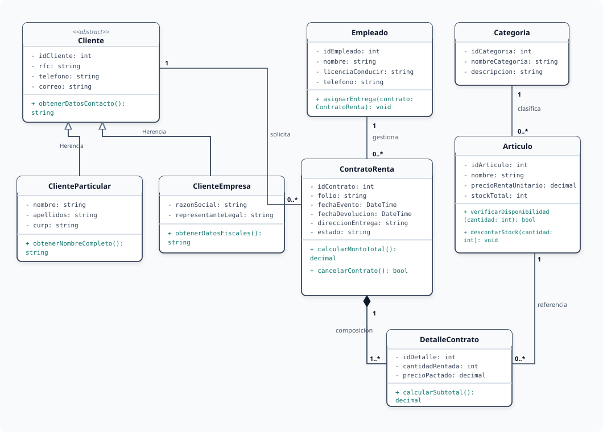

# Portafolio de Evidencias: Fundamentos de Bases de Datos

[](https://github.com/sheylanga/Bases_Datos.git)
[](https://www.monclova.tecnm.mx/)
[]()

---

# 1. Mi Repositorio

- **Enlace al Repositorio Oficial en GitHub:** [https://github.com/sheylanga/Bases_Datos.git](https://github.com/sheylanga/Bases_Datos.git)
- **Autora:** Sheyla Estefanía Moncada Guel
- **Matrícula Estudiantil:** I24050388
- **Asignatura:** Fundamentos de Bases de Datos
- **Carrera:** Ingeniería en Sistemas Computacionales / Tecnologías de la Información
- **Institución:** Instituto Tecnológico Superior Campus Monclova (TecNM)

---

# 2. README

Bienvenido al repositorio central de **Fundamentos de Bases de Datos**. Este espacio recopila de forma estructurada, analítica y técnica todo el trabajo teórico y práctico desarrollado a lo largo del curso académico, abarcando desde los principios arquitectónicos y modelos de bases de datos, hasta el diseño conceptual avanzado (E-R / EER), el mapeo a diagramas de clases UML, el modelo relacional, la normalización matemática (1FN a 3FN) y la implementación física mediante scripts DDL en SQL con validación por ingeniería inversa.

Todos los documentos originales en formato PDF han sido digitalizados y convertidos integralmente a **Markdown (.md)**, y cada esquema, diagrama de entidad-relación y modelo visual ha sido reconstruido en **formato vectorial escalable (SVG)** nativo y en **notación Mermaid** para garantizar una visualización nítida, profesional e interactiva sin pérdida de calidad.

### Estructura del Repositorio y Mapa de Archivos:

```text
bases - riojas/
├── README.md                                      # Documento principal y guía del repositorio
├── Unidad1.pdf                                    # PDF original: Unidad 1
├── U1_I24050388.pdf                               # PDF oficial: Unidad 1
├── U2_I24050388.pdf                               # PDF oficial: Unidad 2
├── Actividad 6 U2.pdf                             # PDF oficial: Actividad 6 Unidad 2 (UML)
├── U3_I24050388.pdf                               # PDF oficial: Unidad 3
├── Actividad 3 U3.pdf                             # PDF oficial: Actividad 3 Unidad 3 (Mapeo)
│
├── Unidad_1/                                      # Contenidos digitalizados Unidad 1
│   ├── Unidad_1.md                                # Contenido teórico y conceptual de Unidad 1
│   ├── Actividades_Unidad_1.md                    # Actividades prácticas y evaluativas Unidad 1
│   └── img/                                       # Gráficos vectoriales SVG de Unidad 1
│       ├── mapa_conceptual_u1.svg
│       ├── cuadro_sinoptico_u1.svg
│       ├── arquitectura_tres_niveles_ansi_sparc.svg
│       └── arquitectura_sgbd.svg
│
├── Unidad_2/                                      # Contenidos digitalizados Unidad 2
│   ├── Unidad_2.md                                # Contenido teórico de Modelo E-R y EER
│   ├── Actividades_Unidad_2.md                    # Actividades 1 a 6 de la Unidad 2
│   └── img/                                       # Gráficos vectoriales SVG de Unidad 2
│       ├── er_hospitalario.svg
│       ├── eer_universitario.svg
│       ├── er_ventas_facturacion.svg
│       ├── er_elearning.svg
│       ├── er_reservaciones_hotel.svg
│       ├── eer_mobiliario_eventos.svg
│       └── uml_clases_mobiliario.svg
│
└── Unidad_3/                                      # Contenidos digitalizados Unidad 3
    ├── Unidad_3.md                                # Contenido teórico del Modelo Relacional
    ├── Actividades_Unidad_3.md                    # Actividades 1 a 4 de la Unidad 3
    └── img/                                       # Gráficos vectoriales SVG de Unidad 3
        ├── relacional_control_escolar.svg
        ├── relacional_comercio_pedidos.svg
        ├── relacional_clinica_medica.svg
        ├── esquema_conceptual_control_escolar.svg
        └── flujo_ingenieria_inversa.svg
```

---

# 3. Unidad 1

La **Unidad 1** aborda los cimientos teóricos y arquitectónicos indispensables de los sistemas de información basados en datos. Se analizan las diferencias sustanciales entre datos brutos e información procesada, el rol neurálgico del Sistema Gestor de Bases de Datos (SGBD / DBMS), y los objetivos primordiales de reducción de redundancia, garantía de integridad, control de concurrencia y tolerancia a fallos.

### Documentación de la Unidad:
- **Documento Teórico Digitalizado:** [Unidad_1/Unidad_1.md](Unidad_1/Unidad_1.md)
- **Archivos Originales en PDF:** [Unidad1.pdf](Unidad1.pdf) / [U1_I24050388.pdf](U1_I24050388.pdf)

### Ejes Temáticos Principales:
1. **Dato vs. Información vs. Base de Datos vs. SGBD:** Definición de conceptos y taxonomía básica.
2. **Arquitectura de Tres Niveles (ANSI/SPARC):** Independencia lógica y física de datos a través de los niveles Externo (Vistas), Conceptual (Lógico) e Interno (Físico en disco).
3. **Arquitectura Interna del SGBD:** Pipeline de ejecución compuesto por Interfaz DML/DDL, Procesador de Consultas, Optimizador de Costo, Gestor de Transacciones y Concurrencia (ACID) y Gestor de Almacenamiento en disco.

#### Vista Previa Vectorial: Arquitectura ANSI/SPARC
<p align="center">
  
</p>

---

# 4. Actividades Unidad 1

Contiene las prácticas analíticas, cuadros comparativos y diagramaciones elaboradas para consolidar los conocimientos de la Unidad 1.

### Enlace al Documento Detallado de Actividades:
- **Archivo Markdown:** [Unidad_1/Actividades_Unidad_1.md](Unidad_1/Actividades_Unidad_1.md)

### Desglose de Actividades:
- **Actividad 1. Mapa Conceptual Analítico:**  
  Representación integral de conceptos fundamentales, objetivos operacionales, modelos de bases de datos y aplicaciones reales (banca, salud, educación, comercio electrónico).  
  *Gráfico vectorial disponible:* [Unidad_1/img/mapa_conceptual_u1.svg](Unidad_1/img/mapa_conceptual_u1.svg)
- **Actividad 2. Tabla Comparativa de 8 Modelos de Bases de Datos:**  
  Evaluación profunda de paradigmas: Modelo Jerárquico, Modelo en Red, Modelo Relacional, Orientado a Objetos (OODBMS), Objeto-Relacional (ORDBMS), NoSQL Documental (MongoDB), NoSQL Clave-Valor (Redis), NoSQL Columnar (Cassandra) y NoSQL Grafos (Neo4j).
- **Actividad 3. Cuadro Sinóptico de Clasificación de Bases de Datos:**  
  Clasificación formal bajo 4 dimensiones: según variabilidad (estáticas vs. dinámicas), ubicación (centralizadas, distribuidas, en la nube DBaaS), modelo de datos (SQL vs. NoSQL) y concurrencia (monousuario vs. multiusuario).  
  *Gráfico vectorial disponible:* [Unidad_1/img/cuadro_sinoptico_u1.svg](Unidad_1/img/cuadro_sinoptico_u1.svg)
- **Actividad 4. Arquitecturas ANSI/SPARC y Funcional del SGBD:**  
  Diagramación e interpretación de la pila modular del motor de base de datos.  
  *Gráfico vectorial disponible:* [Unidad_1/img/arquitectura_sgbd.svg](Unidad_1/img/arquitectura_sgbd.svg)

#### Vista Previa Vectorial: Cuadro Sinóptico de Clasificación
<p align="center">
  
</p>

---

# 5. Unidad 2

La **Unidad 2** se centra en la fase de **Diseño Conceptual**, empleando como herramienta central el **Modelo Entidad-Relación (E-R)** propuesto por Peter Chen y su extensión **E-R Extendido (EER)**. Permite capturar las entidades del mundo real, sus restricciones y su cardinalidad de manera agnóstica a cualquier motor físico.

### Documentación de la Unidad:
- **Documento Teórico Digitalizado:** [Unidad_2/Unidad_2.md](Unidad_2/Unidad_2.md)
- **Archivo Original en PDF:** [U2_I24050388.pdf](U2_I24050388.pdf)

### Ejes Temáticos Principales:
1. **Componentes del Modelo E-R:** Entidades regulares (fuertes) y débiles, taxonomía de atributos (atómicos, compuestos, multivaluados, derivados) y relaciones unarias, binarias y ternarias.
2. **Restricciones de Integridad:** Cardinalidades mínimas y máximas ($1:1$, $1:N$, $N:M$) y participación obligatoria (total) u opcional (parcial).
3. **Constructos del Modelo EER:** Superclases y subclases, especialización (*top-down*), generalización (*bottom-up*), herencia de atributos y restricciones de disyunción (*disjoint* vs. *overlapping*) y completitud (*total* vs. *partial*).

---

# 6. Actividades Unidad 2

Reúne los ejercicios de modelado, diseño en herramientas CASE de software y la transición hacia el paradigma orientado a objetos.

### Enlace al Documento Detallado de Actividades:
- **Archivo Markdown:** [Unidad_2/Actividades_Unidad_2.md](Unidad_2/Actividades_Unidad_2.md)
- **Archivos Originales en PDF:** [U2_I24050388.pdf](U2_I24050388.pdf) / [Actividad 6 U2.pdf](Actividad%206%20U2.pdf)

### Desglose de Actividades:
- **Actividad 1. Reporte sobre Modelo E-R y E-R Extendido:** Fundamentación teórica y reglas de modelado.
- **Actividad 2. Evaluación de Herramientas CASE:** Comparativa técnica entre MySQL Workbench, ERDPlus, Lucidchart y justificación de selección de **dbdiagram.io** con lenguaje DBML.
- **Actividad 3. Modelos E-R y EER Prácticos:**
  - *Modelo E-R Clásico:* Sistema de Gestión Hospitalaria (Especialidad, Médico, Paciente, Cita).  
    *Gráfico:* [Unidad_2/img/er_hospitalario.svg](Unidad_2/img/er_hospitalario.svg)
  - *Modelo E-R Extendido (EER):* Sistema Universitario Integral con herencia ISA $1:1$ de Persona a Estudiante y Profesor.  
    *Gráfico:* [Unidad_2/img/eer_universitario.svg](Unidad_2/img/eer_universitario.svg)
- **Actividad 4. Diagramas E-R de Tres Situaciones de Negocio:**
  - *Situación 1:* Sistema de Ventas y Facturación (Punto de Venta con Detalle_Venta).  
    *Gráfico:* [Unidad_2/img/er_ventas_facturacion.svg](Unidad_2/img/er_ventas_facturacion.svg)
  - *Situación 2:* Plataforma de Cursos en Línea (E-Learning con Lecciones e Inscripción).  
    *Gráfico:* [Unidad_2/img/er_elearning.svg](Unidad_2/img/er_elearning.svg)
  - *Situación 3:* Sistema de Reservaciones de Hotel (Huéspedes, Cuartos y Detalle_Reserva).  
    *Gráfico:* [Unidad_2/img/er_reservaciones_hotel.svg](Unidad_2/img/er_reservaciones_hotel.svg)
- **Actividad 5. Problema del Entorno - Alquiler de Mobiliario para Eventos:**  
  Modelado EER integral con especialización total y disjunta en Clientes Particulares y Empresas, contratos de arrendamiento, choferes logísticos y artículos en inventario.  
  *Gráfico vectorial:* [Unidad_2/img/eer_mobiliario_eventos.svg](Unidad_2/img/eer_mobiliario_eventos.svg)
- **Actividad 6. De Entidad-Relación a Diagramas de Clases UML:**  
  Ponencia técnica sobre la resolución del desfase objeto-relacional (*impedance mismatch*), generalización con clases abstractas, composición fuerte y métodos operativos de dominio para integración con ORMs.  
  *Gráfico vectorial:* [Unidad_2/img/uml_clases_mobiliario.svg](Unidad_2/img/uml_clases_mobiliario.svg)

#### Vista Previa Vectorial: Diagrama de Clases UML (Actividad 6)
<p align="center">
  
</p>

---

# 7. Unidad 3

La **Unidad 3** profundiza en la transición formal del diseño conceptual al **Modelo Relacional** propuesto por Edgar F. Codd (1970). Se cubren las estructuras tabulares matemáticas, el álgebra relacional, la integridad referencial estricta y los fundamentos de la teoría de normalización.

### Documentación de la Unidad:
- **Documento Teórico Digitalizado:** [Unidad_3/Unidad_3.md](Unidad_3/Unidad_3.md)
- **Archivo Original en PDF:** [U3_I24050388.pdf](U3_I24050388.pdf)

### Ejes Temáticos Principales:
1. **Componentes Relacionales:** Relación (tabla), Tupla (fila), Atributo (columna), Dominio de datos, Grado y Cardinalidad.
2. **Axiomas de Integridad:** Integridad de Entidad (`PK NOT NULL`), Integridad Referencial (`FK`), Integridad de Dominio (`CHECK` y tipos atómicos) e Integridad de Usuario.
3. **Formas Normales:**
   - **Primera Forma Normal (1FN):** Atomicidad absoluta de valores sin grupos repetitivos.
   - **Segunda Forma Normal (2FN):** Eliminación de dependencias parciales en claves compuestas.
   - **Tercera Forma Normal (3FN):** Supresión de dependencias funcionales transitivas entre atributos no clave.

---

# 8. Actividades Unidad 3

Presenta la materialización de esquemas relacionales, el procedimiento sistemático de transformación E-R a Relacional y la implementación en código SQL ejecutable con comprobación por ingeniería inversa.

### Enlace al Documento Detallado de Actividades:
- **Archivo Markdown:** [Unidad_3/Actividades_Unidad_3.md](Unidad_3/Actividades_Unidad_3.md)
- **Archivos Originales en PDF:** [U3_I24050388.pdf](U3_I24050388.pdf) / [Actividad 3 U3.pdf](Actividad%203%20U3.pdf)

### Desglose de Actividades:
- **Actividad 1. Modelo Relacional y Reglas de Integridad:**  
  Especificación de axiomas y matriz comparativa de formas normales (1FN, 2FN, 3FN, FNBC).
- **Actividad 2. Esquemas Relacionales de Tres Casos de Estudio:**
  - *Caso 1:* Sistema de Control Escolar Universitario (Alumno, Docente, Materia, Grupo, Inscripción).  
    *Gráfico:* [Unidad_3/img/relacional_control_escolar.svg](Unidad_3/img/relacional_control_escolar.svg)
  - *Caso 2:* Plataforma de Comercio Electrónico y Pedidos (Congelamiento de precio unitario histórico).  
    *Gráfico:* [Unidad_3/img/relacional_comercio_pedidos.svg](Unidad_3/img/relacional_comercio_pedidos.svg)
  - *Caso 3:* Gestión de Consultas y Citas en Clínica Médica (Diagnósticos y prescripciones farmacológicas).  
    *Gráfico:* [Unidad_3/img/relacional_clinica_medica.svg](Unidad_3/img/relacional_clinica_medica.svg)
- **Actividad 3. Transformación del Modelo E-R al Modelo Relacional:**  
  Ponencia técnica sobre las reglas canónicas de conversión: entidades regulares a tablas base, resolución de relaciones $1:N$ por migración de PK a FK, y relaciones $M:N$ mediante tablas puente asociativas, garantizando el cumplimiento pleno de 3FN.
- **Actividad 4. Implementación Física DDL (SQL) e Ingeniería Inversa:**  
  Script SQL estandarizado completo y ejecutable para MySQL / PostgreSQL:
  - Base de datos con cotejamiento `utf8mb4_unicode_ci`.
  - Tablas `alumno`, `docente`, `materia`, `grupo` e `inscripcion`.
  - Políticas de acción referencial `ON UPDATE CASCADE`, `ON DELETE RESTRICT` y `ON DELETE CASCADE`.
  - Verificación mediante el asistente de **Ingeniería Inversa** en herramientas CASE para generar el diagrama físico en 3FN.  
  *Gráfico vectorial del flujo:* [Unidad_3/img/flujo_ingenieria_inversa.svg](Unidad_3/img/flujo_ingenieria_inversa.svg)

#### Vista Previa Vectorial: Esquema Relacional de Control Escolar (Actividad 2 y 4)
<p align="center">
  
</p>

---

## Información Institucional y Créditos

- **Instituto Tecnológico Superior Campus Monclova (TecNM)**
- **Docente:** Dr. / M.C. Riojas
- **Alumna:** Sheyla Estefanía Moncada Guel
- **Matrícula:** I24050388
- **Semestre:** 2026
- **Repositorio:** [https://github.com/sheylanga/Bases_Datos.git](https://github.com/sheylanga/Bases_Datos.git)
