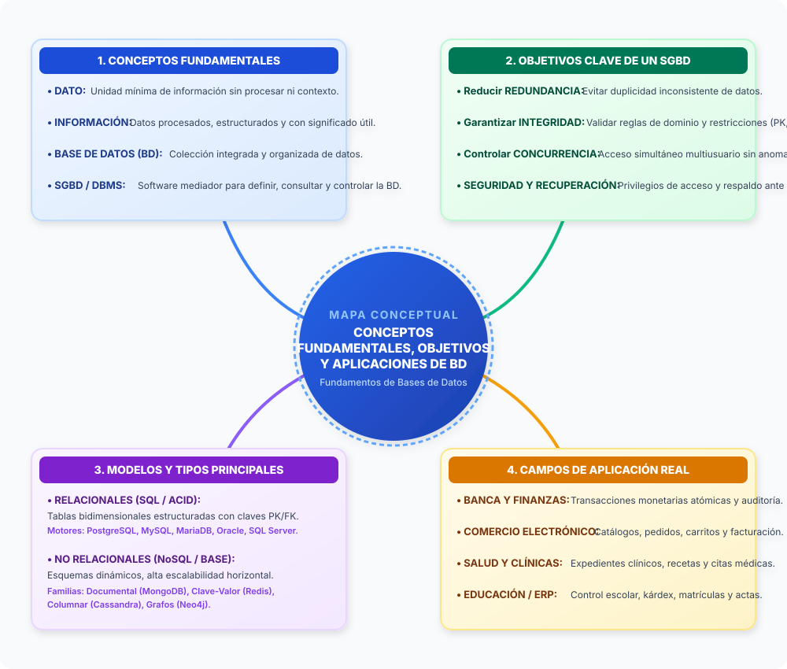
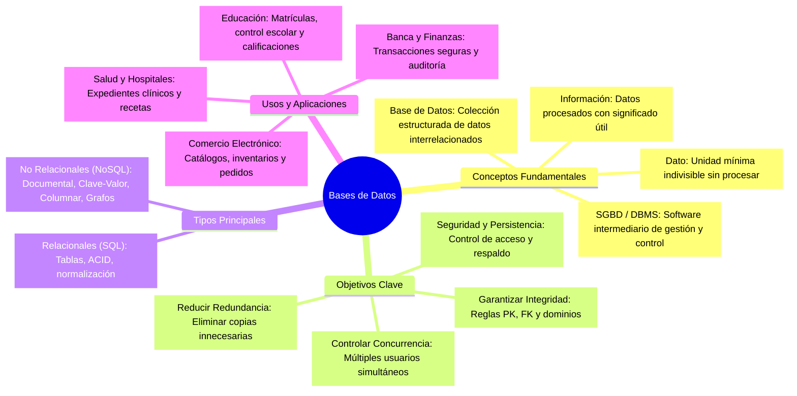
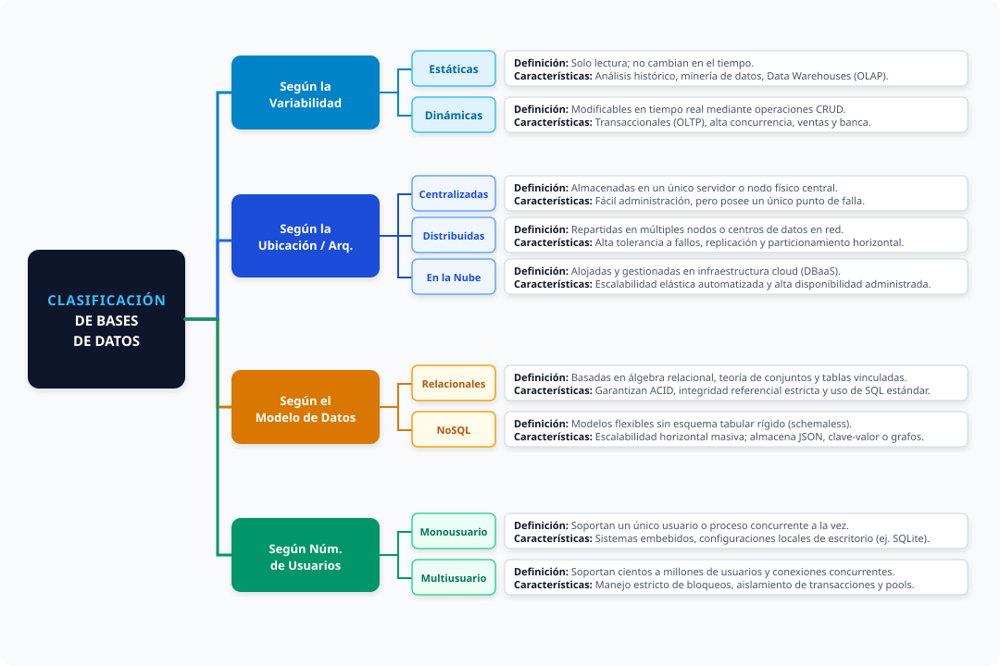
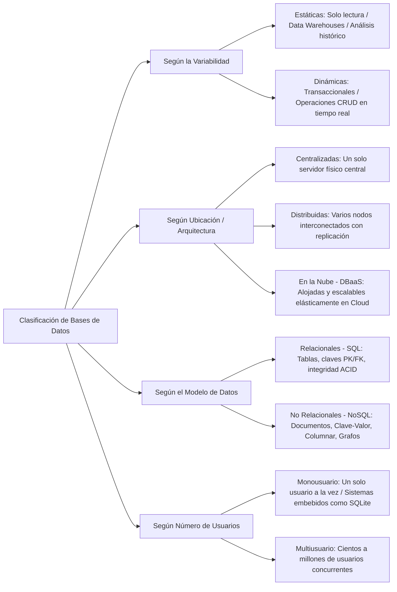
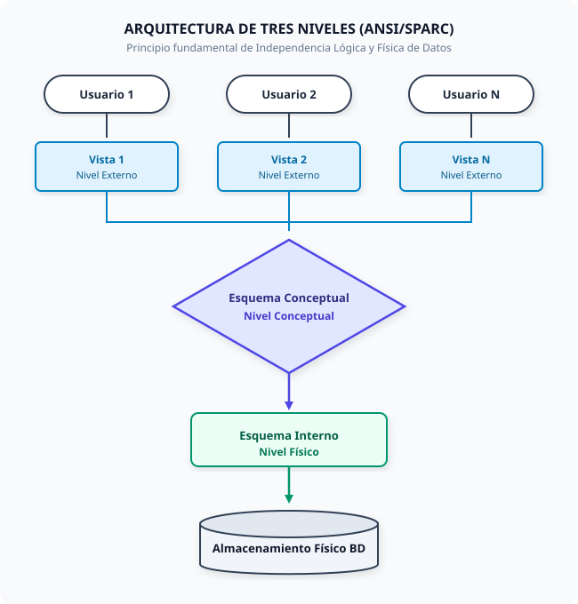
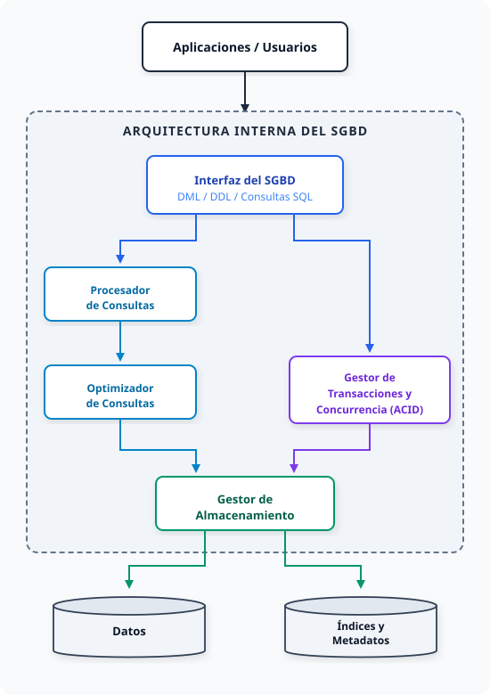

# Actividades Unidad 1: Fundamentos y Arquitectura

> **Materia:** Fundamentos de Bases de Datos  
> **Estudiante:** Sheyla Estefanía Moncada Guel  
> **Matrícula:** I24050388  
> **Institución:** Instituto Tecnológico Superior Campus Monclova  
> **Documentos Fuente:** [Unidad1.pdf](../Unidad1.pdf) / [U1_I24050388.pdf](../U1_I24050388.pdf)

---

## Índice de Actividades

1. [Actividad 1. Mapa Conceptual Analítico](#actividad-1-mapa-conceptual-analítico)
2. [Actividad 2. Tabla Comparativa de Modelos de Bases de Datos](#actividad-2-tabla-comparativa-de-modelos-de-bases-de-datos)
3. [Actividad 3. Cuadro Sinóptico de Clasificación](#actividad-3-cuadro-sinóptico-de-clasificación)
4. [Actividad 4. Arquitectura de Tres Niveles y Arquitectura del SGBD](#actividad-4-arquitectura-de-tres-niveles-y-arquitectura-del-sgbd)

---

## Actividad 1. Mapa Conceptual Analítico

El mapa conceptual sintetiza los conceptos fundacionales, objetivos operacionales, tipologías y campos de aplicación de las bases de datos modernas:

### Gráfico Vectorial (SVG Escala Completa)

### Representación Estructural en Código Mermaid

---

## Actividad 2. Tabla Comparativa de Modelos de Bases de Datos

A continuación se presenta el análisis comparativo detallado de los paradigmas de bases de datos que han definido la evolución del almacenamiento de información:

| Modelo de Base de Datos | Definición Conceptual | Representación de Datos | Principales Ventajas / Casos de Uso | Motores Representativos |
| :--- | :--- | :--- | :--- | :--- |
| **Modelo Jerárquico** | Organiza los datos en una estructura de árbol invertido donde cada registro tiene un único nodo padre (relación 1:N estricta). | **Árbol / Nodos y Ramas:** Registros padre e hijos interconectados mediante punteros de jerarquía fija. | Acceso sumamente veloz en datos con dependencias jerárquicas naturales fijas. Sistemas de telecomunicaciones legacy y sistemas de archivos. | IBM IMS, Windows Registry. |
| **Modelo en Red** | Extensión del modelo jerárquico que permite relaciones de muchos a muchos ($N:M$); un nodo hijo puede tener múltiples nodos padres. | **Grafo de Conjuntos (*Sets*):** Nodos propietarios (*owners*) y miembros vinculados a través de listas y punteros bidireccionales. | Elimina la redundancia estricta del modelo jerárquico en relaciones complejas de muchos a muchos. | Integrated Data Store (IDS), IDMS. |
| **Modelo Relacional** | Estructura la información en relaciones matemáticas basadas en el álgebra relacional y la teoría de conjuntos; garantiza propiedades ACID. | **Tablas bidimensionales:** Filas (tuplas/registros) y columnas (campos/atributos), vinculadas mediante claves primarias (`PK`) y foráneas (`FK`). | Integridad referencial robusta, lenguaje estándar universal (SQL), independencia física y lógica de datos y normalización matemática. | PostgreSQL, MariaDB, MySQL, Microsoft SQL Server, Oracle Database. |
| **Modelo Orientado a Objetos (OODBMS)** | Integra directamente los conceptos de la Programación Orientada a Objetos (POO), encapsulando datos y métodos en una sola unidad persistente. | **Objetos y Clases:** Instancias persistidas con identificador único de objeto (`OID`), encapsulamiento, métodos de comportamiento y polimorfismo. | Elimina completamente el desfase objeto-relacional (*impedance mismatch*) en aplicaciones con lógica y dominios altamente complejos. | ObjectDB, db4o, Versant. |
| **Modelo Objeto-Relacional (ORDBMS)** | Híbrido que extiende el motor relacional tradicional agregando soporte para tipos de datos complejos definidos por el usuario, arrays y herencia de tablas. | **Tablas con tipos avanzados:** Filas relacionales estándar combinadas con User-Defined Types (UDT), tipos geoespaciales (GIS) y JSON nativo. | Gran flexibilidad para modelar datos multimedia, científicos o jerárquicos conservando la compatibilidad completa con el estándar SQL. | PostgreSQL, Oracle Database, IBM Informix. |
| **Modelo NoSQL: Documental** | Almacena información en estructuras semiestructuradas autocontenidas y sin un esquema previo obligatorio (*schemaless*). | **Documentos (JSON / BSON / XML):** Pares clave-valor anidados con arreglos internos y subdocumentos agrupados en colecciones. | Escalabilidad horizontal nativa, flexibilidad para cambios continuos de producto y desarrollo ágil en aplicaciones web y móviles modernas. | MongoDB, Apache CouchDB, Amazon DocumentDB. |
| **Modelo NoSQL: Clave-Valor** | Modelo minimalista de latencia ultrabaja que asocia una clave alfanumérica única con un bloque de datos estructurado o binario opaco. | **Diccionario / Hash Map:** Pares exactos (`Clave`, `Valor`) almacenados preferentemente en memoria volátil o NVMe. | Máximo rendimiento de lectura/escritura en microsegundos; ideal para caché de sesiones de usuario, carros de compras y colas de mensajes. | Redis, Memcached, Amazon DynamoDB. |
| **Modelo NoSQL: Columnar (Wide-Column)** | Agrupa y almacena los datos físicamente en disco ordenados por columnas en lugar de filas, optimizando lecturas analíticas masivas. | **Familias de Columnas (*Column Families*):** Filas dinámicas identificadas por una clave, donde cada fila puede poseer distintas columnas con marcas de tiempo (*timestamps*). | Consultas analíticas ultrarrápidas sobre terabytes de datos (OLAP), minería de datos, registros de auditoría y análisis de series de tiempo. | Apache Cassandra, Apache HBase, ScyllaDB. |
| **Modelo NoSQL: Grafos** | Enfatiza las relaciones entre elementos como entidades de primer nivel aplicando principios formales de la teoría de grafos. | **Nodos, Aristas y Propiedades:** Nodos que representan entidades interconectados por aristas dirigidas y tipificadas con atributos en tiempo constante. | Rendimiento insuperable en navegación de relaciones de alta profundidad; redes sociales, detección de fraudes bancarios y motores de recomendación. | Neo4j, Amazon Neptune, ArangoDB. |

---

## Actividad 3. Cuadro Sinóptico de Clasificación

El siguiente cuadro clasifica formalmente los sistemas gestores de bases de datos de acuerdo con cuatro criterios fundamentales:

### Gráfico Vectorial (SVG Escala Completa)

### Representación Estructural en Código Mermaid

---

## Actividad 4. Arquitectura de Tres Niveles y Arquitectura del SGBD

### 1. Arquitectura de Tres Niveles (ANSI/SPARC)

Garantiza la independencia lógica y física de datos mediante tres capas desacopladas:

- **Nivel Externo:** Representado por las interfaces o vistas de los diferentes usuarios (`Vista 1`, `Vista 2`, `Vista N`), adaptadas a su rol operativo.
- **Nivel Conceptual:** Modelo unificado de todas las entidades y vínculos del negocio (`Esquema Conceptual`).
- **Nivel Interno:** Especificaciones de almacenamiento físico, métodos de direccionamiento y compresión (`Esquema Interno`).
- **Almacenamiento Físico:** Discos duros magnéticos, arreglos SSD y medios magnéticos.

### 2. Arquitectura Funcional Interna del SGBD

Esquema de componentes y tubería de procesamiento de órdenes:

- **Flujo de Peticiones:** La aplicación envía una sentencia SQL a la **Interfaz del SGBD**.
- **Evaluación y Optimización:** El **Procesador de Consultas** valida la sintaxis y el **Optimizador** elige el camino de acceso de menor costo en disco.
- **Control Concurrente y ACID:** El **Gestor de Transacciones** asegura atomicidad, control de bloqueos e interactúa con el log de transacciones.
- **Persistencia en Disco:** El **Gestor de Almacenamiento** lee y escribe páginas de datos en el subsistema de archivos del sistema operativo, actualizando índices y metadatos.
