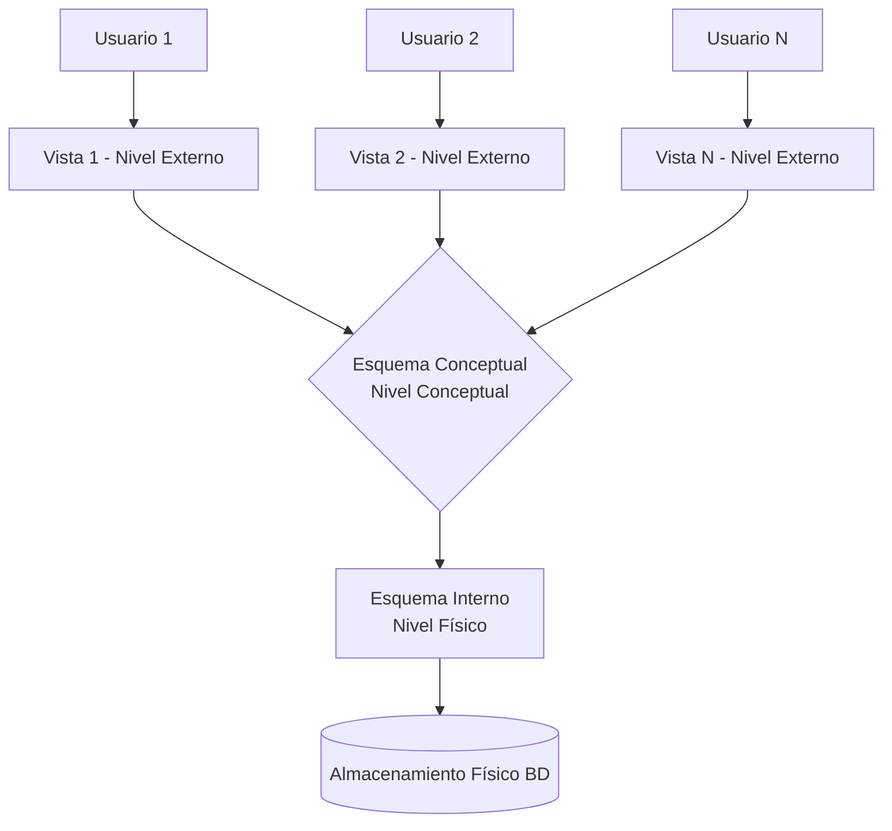
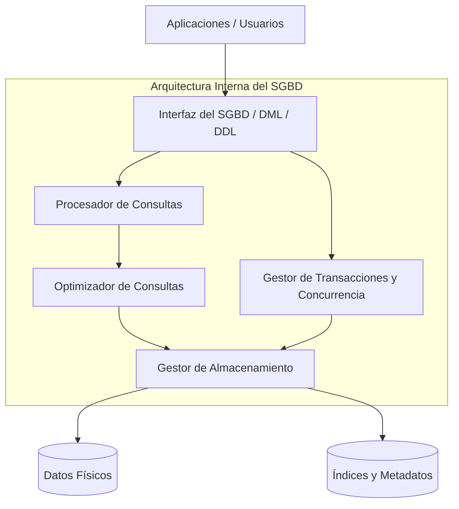

# Unidad 1: Fundamentos de Bases de Datos

> **Materia:** Fundamentos de Bases de Datos  
> **Estudiante:** Sheyla Estefanía Moncada Guel  
> **Matrícula:** I24050388  
> **Institución:** Instituto Tecnológico Superior Campus Monclova  
> **Archivo Original:** [Unidad1.pdf](../Unidad1.pdf) / [U1_I24050388.pdf](../U1_I24050388.pdf)

---

## 1. Introducción y Conceptos Fundamentales

En la sociedad de la información actual, los datos constituyen el activo digital más valioso de cualquier organización. Una **Base de Datos (BD)** es una colección estructurada, integrada y organizada de datos interrelacionados, que modelan el estado y las operaciones de un sistema del mundo real (banca, educación, salud, comercio electrónico, entre otros).

Para gestionar, proteger y consultar estos volúmenes de datos surge el **Sistema Gestor de Bases de Datos (SGBD / DBMS - *Database Management System*)**, el cual actúa como intermediario entre los usuarios finales, el software de aplicación y los medios de almacenamiento físico.

### Definiciones Principales:
- **Dato:** Unidad mínima de información sin procesar, carente de contexto inmediato (ej. `25`, `Monclova`, `A1`).
- **Información:** Conjunto de datos organizados, correlacionados y procesados con valor significativo para la toma de decisiones.
- **Base de Datos:** Conjunto unificado de datos persistentes protegidos bajo reglas de integridad.
- **SGBD:** Suite de software especializada que proporciona una interfaz declarativa estándar (DDL, DML, DCL), optimización de recursos, control transaccional ACID y respaldo seguro.

---

## 2. Objetivos Clave de un Sistema Gestor de Bases de Datos

Un SGBD moderno resuelve las problemáticas inherentes a los antiguos sistemas de procesamiento de archivos (*File System Approach*), asegurando los siguientes pilares:

1. **Reducción de la Redundancia:** Almacenamiento unificado para minimizar la presencia de copias duplicadas innecesarias y prevenir inconsistencias de actualización (*update anomalies*).
2. **Garantía de Integridad de Datos:** Imposición rigurosa de reglas de validación semánticas, claves primarias (`PK`), claves foráneas (`FK`), restricciones `CHECK`, tipos de datos y unicidad `UNIQUE`.
3. **Control de Concurrencia:** Mecanismos de aislamiento que permiten el acceso y modificación simultánea por miles de usuarios concurrentes sin que se presenten pérdidas de actualización (*lost updates*) o lecturas sucias (*dirty reads*).
4. **Seguridad y Confidencialidad:** Asignación granular de privilegios y permisos por rol o usuario, protegiendo la información sensible contra accesos no autorizados.
5. **Persistencia y Recuperación ante Fallos:** Mecanismos basados en archivos de bitácora (*Write-Ahead Logging*) que garantizan la atomicidad y durabilidad de las transacciones ante apagones o caídas de hardware.
6. **Independencia de Datos:** Aislamiento entre la vista lógica que perciben los programas y la implementación física en disco.

---

## 3. Arquitectura de Tres Niveles (ANSI/SPARC)

La arquitectura ANSI/SPARC, propuesta por el grupo de estudio de la American National Standards Institute en 1975, define el marco conceptual estándar para separar la interacción del usuario de la representación física interna:

### Desglose de los Tres Niveles:
1. **Nivel Externo (Vistas):**
   - Es el nivel más cercano al usuario final o a la aplicación consumidora.
   - Proporciona vistas personalizadas y filtradas de la base de datos, restringiendo el acceso únicamente a los datos pertinentes según el perfil de seguridad.
2. **Nivel Conceptual (Lógico):**
   - Representa la visión global y unificada de la base de datos completa.
   - Define todas las entidades, relaciones, restricciones de integridad y tipos de datos de la empresa, sin preocuparse por la distribución física en el hardware.
   - Otorga **Independencia Lógica de Datos** (cambios en el esquema conceptual no deben alterar las vistas externas que no utilicen dichos atributos).
3. **Nivel Interno (Físico):**
   - Describe minuciosamente cómo se almacenan físicamente los datos en las unidades de disco o memoria masiva.
   - Involucra estructuras de archivos (Heap, B-Trees, Hash), punteros, métodos de ordenamiento, técnicas de compresión y mecanismos de cifrado.
   - Otorga **Independencia Física de Datos** (la modificación de índices o reubicación de discos no impacta al nivel conceptual).

---

## 4. Arquitectura Funcional Interna del SGBD

El motor interno de un SGBD se compone de módulos funcionales interconectados para transformar consultas declarativas de alto nivel en accesos eficientes a bloques físicos:

### Módulos Principales:
- **Interfaz y Herramientas:** Puntos de entrada para sentencias SQL (DML, DDL), conectores ODBC/JDBC y utilidades administrativas.
- **Procesador de Consultas (*Query Processor*):** Realiza el análisis léxico, sintáctico y semántico del código SQL, verificando permisos en el catálogo del sistema.
- **Optimizador de Consultas (*Query Optimizer*):** Genera múltiples planes de ejecución y calcula el plan de menor costo computacional (I/O en disco y consumo de CPU) utilizando algoritmos y estadísticas de distribución de datos.
- **Gestor de Transacciones y Concurrencia (*Transaction Manager*):** Coordina los bloqueos (*locks*), supervisa el protocolo de confirmación en dos fases y asegura el cumplimiento estricto de las propiedades **ACID** (Atomicidad, Consistencia, Aislamiento y Durabilidad).
- **Gestor de Almacenamiento (*Storage Manager*):** Administra el buffer pool en memoria RAM, asigna páginas en disco, gestiona el espacio libre e interactúa directamente con las llamadas de bajo nivel del sistema operativo.

---

## 5. Referencias Bibliográficas

- **ANSI/X3/SPARC Study Group on Data Base Management Systems.** (1975). *Interim Report 75-02-08*. ACM SIGMOD Record, 7(2), 1-140.
- **Booch, G., Rumbaugh, J., & Jacobson, I.** (2006). *El Lenguaje Unificado de Modelado: Guía del Usuario* (2.ª ed.). Pearson Educación / Addison-Wesley.
- **Date, C. J.** (2004). *Introducción a los sistemas de bases de datos* (8.ª ed.). Pearson Educación.
- **Elmasri, R., & Navathe, S. B.** (2016). *Fundamentals of Database Systems* (7th ed.). Pearson.
- **Kendall, K. E., & Kendall, J. E.** (2011). *Análisis y diseño de sistemas* (8.ª ed.). Pearson Educación.
- **Kroenke, D. M., & Auer, D. J.** (2015). *Database Concepts* (7th ed.). Pearson.
- **Pressman, R. S., & Maxim, B. R.** (2021). *Ingeniería del software: Un enfoque práctico* (9.ª ed.). McGraw-Hill Interamericana.
- **Ramakrishnan, R., & Gehrke, J.** (2003). *Database Management Systems* (3rd ed.). McGraw-Hill.
- **Silberschatz, A., Korth, H. F., & Sudarshan, S.** (2020). *Database System Concepts* (7th ed.). McGraw-Hill Education.
