# Actividades Unidad 2: Modelado Conceptual E-R, EER y UML

> **Materia:** Fundamentos de Bases de Datos  
> **Estudiante:** Sheyla Estefanía Moncada Guel  
> **Matrícula:** I24050388  
> **Institución:** Instituto Tecnológico Superior Campus Monclova  
> **Documentos Fuente:** [U2_I24050388.pdf](../U2_I24050388.pdf) / [Actividad 6 U2.pdf](../Actividad%206%20U2.pdf)

---

## Índice de Actividades

1. [Actividad 1. Reporte sobre Modelo E-R y E-R Extendido](#actividad-1-reporte-sobre-modelo-e-r-y-e-r-extendido)
2. [Actividad 2. Herramientas de Software para el Modelado](#actividad-2-herramientas-de-software-para-el-modelado)
3. [Actividad 3. Modelos E-R y EER Prácticos](#actividad-3-modelos-e-r-y-eer-prácticos)
4. [Actividad 4. Diagramas E-R de Tres Situaciones de Negocio](#actividad-4-diagramas-e-r-de-tres-situaciones-de-negocio)
5. [Actividad 5. Problema del Entorno: Alquiler de Mobiliario](#actividad-5-problema-del-entorno-alquiler-de-mobiliario)
6. [Actividad 6. De Entidad-Relación a Diagramas de Clases UML](#actividad-6-de-entidad-relación-a-diagramas-de-clases-uml)

---

## Actividad 1. Reporte sobre Modelo E-R y E-R Extendido

El Modelo Entidad-Relación (E-R) es una herramienta conceptual de diseño que permite proyectar gráficamente la estructura informativa de un sistema antes de su implementación física. 

### Síntesis Teórica de Componentes y Reglas:
- **Entidades Fuertes y Débiles:** Las entidades regulares (`Alumno`, `Cliente`) se identifican por sus propios atributos primarios; las débiles (`Lección`, `Detalle`) dependen semántica y referencialmente de una entidad padre.
- **Tipología de Atributos:** División formal en simples (atómicos), compuestos (`calle`, `número`, `colonia`), monovaluados, multivaluados (`teléfonos`) y calculados/derivados (`edad`).
- **Restricciones de Integridad:** Cardinalidades mínimas y máximas ($1:1$, $1:N$, $N:M$) y modalidades de participación total o parcial.
- **Constructos EER:** Especialización (*Top-Down*), Generalización (*Bottom-Up*), Herencia estricta de atributos y restricciones de Disyunción (*Disjoint* vs *Overlapping*) y Completitud (*Total* vs *Partial*).

---

## Actividad 2. Herramientas de Software para el Modelado

A fin de seleccionar el entorno de software óptimo para la diagramación y el diseño conceptual durante el curso, se elaboró una matriz de evaluación comparativa:

| Herramienta | Características Principales | Ventajas Destacadas | Desventajas / Limitaciones |
| :--- | :--- | :--- | :--- |
| **MySQL Workbench** | Herramienta integral de escritorio oficial de Oracle para diseño visual, administración y reverse/forward engineering en MySQL. | Extremadamente completa; genera automáticamente scripts DDL y sincroniza cambios directos en el servidor. | Curva de aprendizaje empinada para principiantes; interfaz pesada y ligada prioritariamente al dialecto MySQL. |
| **ERDPlus** | Herramienta académica ligera y basada en navegador web para crear diagramas E-R de notación Chen y esquemas relacionales tabulares. | Muy sencilla, gratuita, accesible al instante sin instalación; ideal para prácticas introductorias de clase. | Carece de funciones de colaboración avanzada en equipo, exportación DDL limitada y estética visual austera. |
| **dbdiagram.io** | Plataforma moderna en la nube orientada a desarrolladores basada en el lenguaje declarativo DBML (*Database Markup Language*). | Rápida, visualización en tiempo real, renderizado limpio con notación pata de gallo, exportación a SQL estándar e integrable con GitHub. | Requiere aprender la sintaxis básica de DBML para exprimir su máximo potencial; ciertas opciones de equipo son de pago. |
| **Lucidchart** | Suite integral en la nube para diagramación general (diagramas de flujo, E-R, UML, redes y arquitectura de software). | Interfaz intuitiva *drag-and-drop*, soporte nativo para colaboración multiusuario simultánea en tiempo real. | Modelo Freemium con severas restricciones en la cuenta gratuita (límite de 3 documentos y máximo 60 objetos). |

### Justificación de la Herramienta Seleccionada: dbdiagram.io
Se seleccionó oficialmente **dbdiagram.io** como el entorno estándar para el desarrollo de las actividades del parcial debido a que:
1. Permite codificar la estructura de tablas, campos y relaciones mediante **DBML**, facilitando la trazabilidad ágil entre el diseño conceptual y las sentencias DDL.
2. Genera de forma automatizada conectores relacionales de tipo *Crow's Foot* ($1:1$, $1:N$, $N:M$) con alta fidelidad visual.
3. Opera completamente en línea y en el navegador, permitiendo compartir y exportar esquemas instantáneamente en formatos SVG, PNG y código SQL estándar.

---

## Actividad 3. Modelos E-R y EER Prácticos

### 1. Modelo E-R Clásico: Sistema de Gestión Hospitalaria
Esquema transaccional con entidades regulares y relaciones de cardinalidad $1:N$:
- `ESPECIALIDAD` agrupa a varios `MEDICO`s ($1:N$).
- `PACIENTE` agenda múltiples `CITA`s médicas ($1:N$).
- `MEDICO` atiende múltiples `CITA`s ($1:N$).

#### Diagrama Vectorial (SVG)
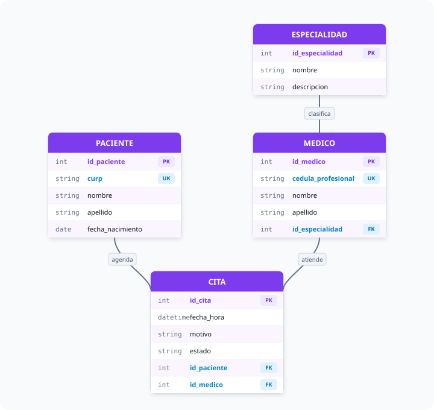

#### Notación Mermaid
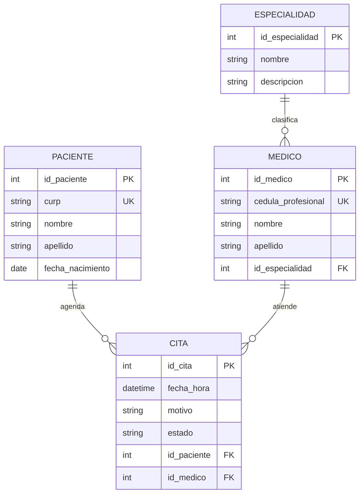

---

### 2. Modelo E-R Extendido (EER): Sistema Universitario Integral
Incorpora jerarquías de herencia y entidades asociativas:
- `PERSONA` se especializa con herencia ISA $1:1$ en `ESTUDIANTE` y `PROFESOR`.
- `PROFESOR` imparte `GRUPO`s ($1:N$).
- `MATERIA` se oferta en múltiples `GRUPO`s ($1:N$).
- La relación $N:M$ entre `ESTUDIANTE` y `GRUPO` se descompone en la entidad asociativa `INSCRIPCION`.

#### Diagrama Vectorial (SVG)
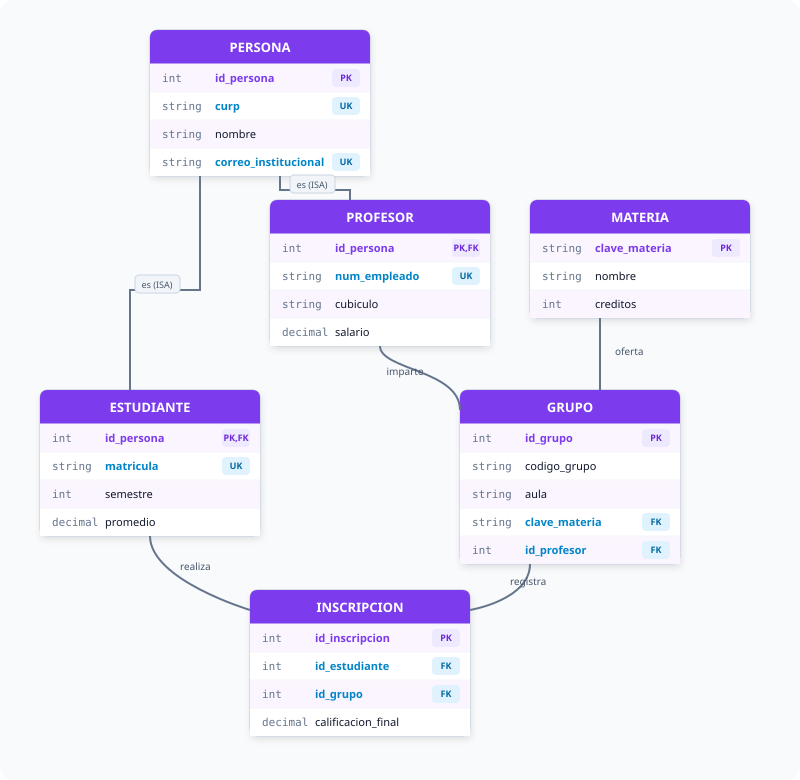

#### Notación Mermaid
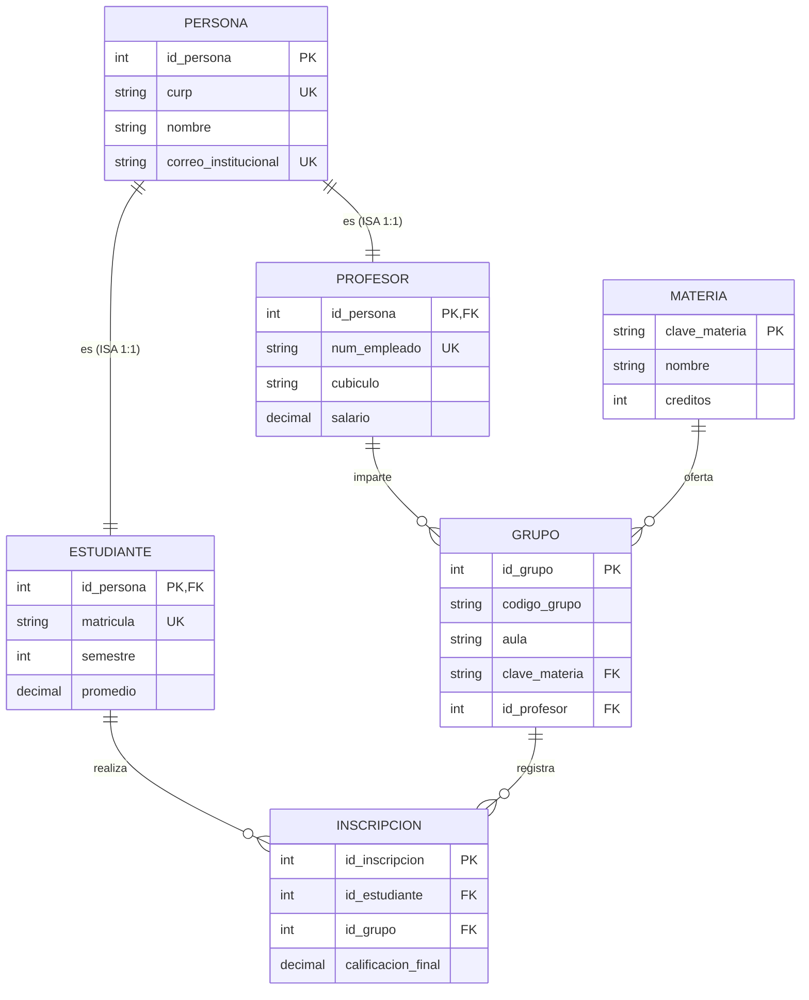

---

## Actividad 4. Diagramas E-R de Tres Situaciones de Negocio

### Situación 1: Sistema de Ventas y Facturación (Punto de Venta)
- Un `CLIENTE` realiza múltiples `VENTA`s ($1:N$).
- La relación $N:M$ entre `VENTA` y `PRODUCTO` se descompone en `DETALLE_VENTA` para congelar el precio unitario y la cantidad vendida históricamente.

#### Diagrama Vectorial (SVG)
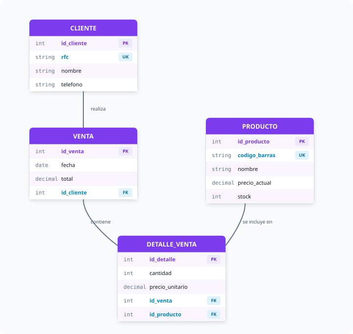

#### Notación Mermaid
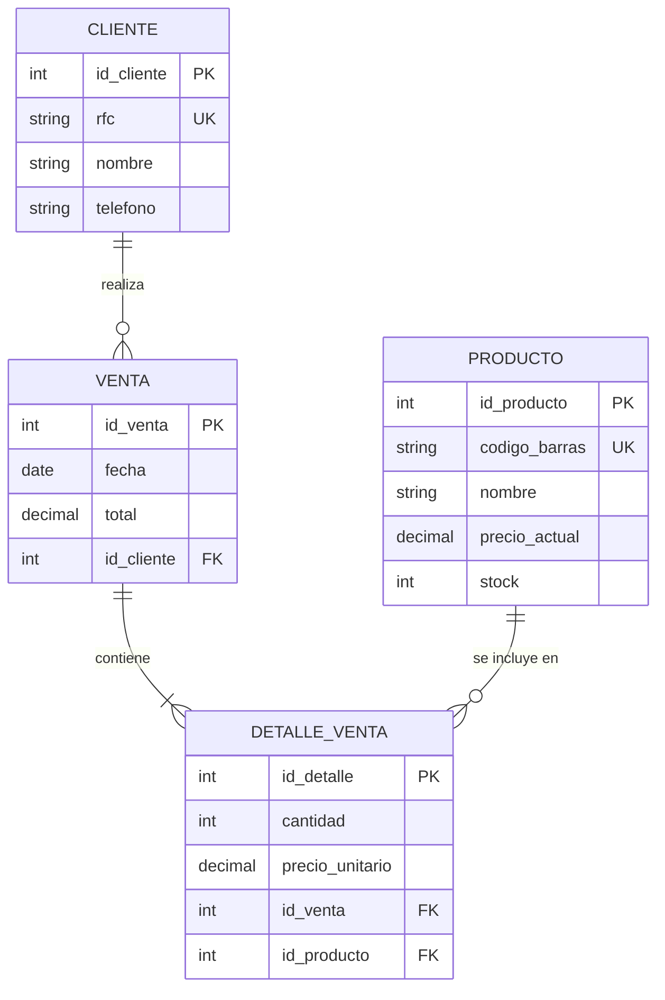

---

### Situación 2: Plataforma de Cursos en Línea (E-Learning)
- Un `INSTRUCTOR` imparte múltiples `CURSO`s ($1:N$).
- Cada `CURSO` se compone secuencialmente de `LECCION`es dependientes ($1:N$).
- Los `ESTUDIANTE`s y `CURSO`s se asocian en la entidad asociativa `INSCRIPCION` ($N:M$) con fecha de alta y calificación final.

#### Diagrama Vectorial (SVG)
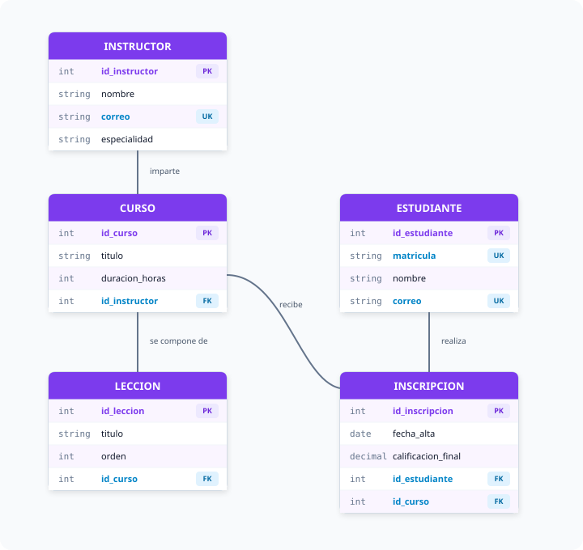

#### Notación Mermaid
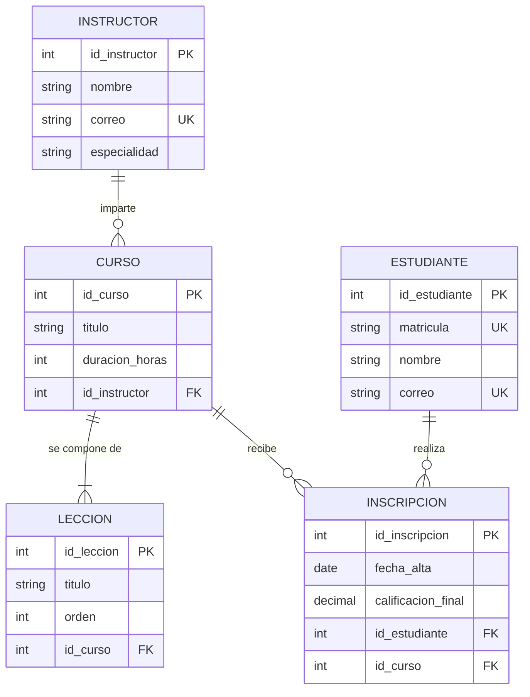

---

### Situación 3: Sistema de Reservaciones de Hotel
- Un `HUESPED` solicita múltiples `RESERVACION`es ($1:N$).
- El catálogo `TIPO_HABITACION` clasifica a las `HABITACION`es físicas ($1:N$).
- La relación $N:M$ entre `RESERVACION` y `HABITACION` se descompone en la tabla puente `DETALLE_RESERVA` para almacenar el subtotal por cuarto asignado.

#### Diagrama Vectorial (SVG)
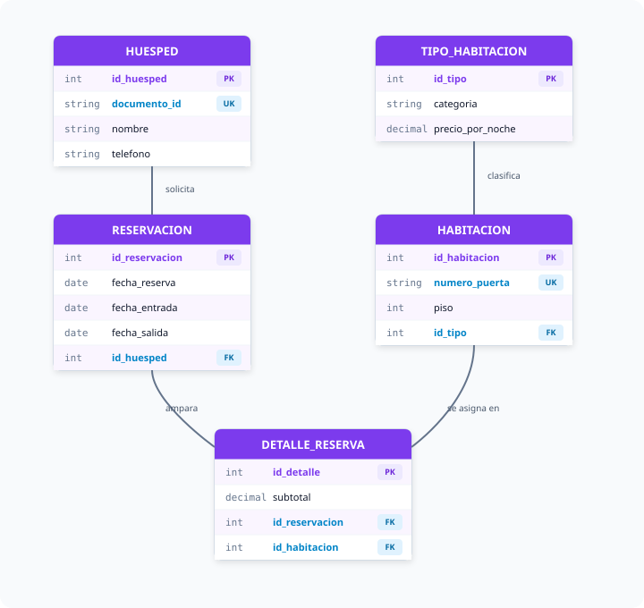

#### Notación Mermaid
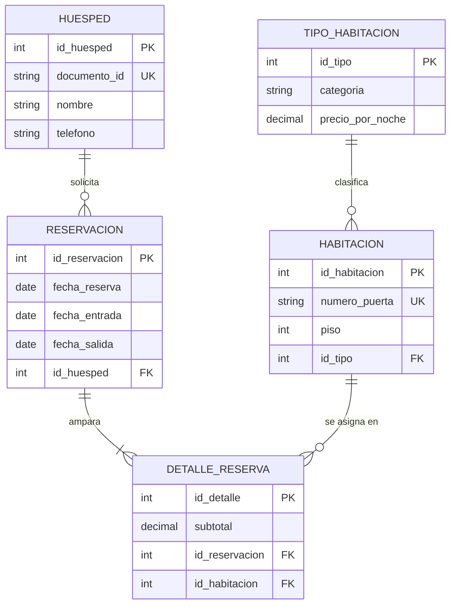

---

## Actividad 5. Problema del Entorno: Alquiler de Mobiliario para Eventos

### 1. Descripción del Entorno y Reglas de Negocio
Una empresa especializada en el arrendamiento de mobiliario y logística para eventos corporativos y sociales requiere sistematizar sus procesos de control de inventario y pedidos:
1. **Clientes y Especialización EER:** Se atiende tanto a personas físicas (`CLIENTE_PARTICULAR`) como a personas morales (`CLIENTE_EMPRESA`). Ambas comparten atributos base (`id_cliente`, `rfc`, `telefono`, `correo`, `tipo_cliente`), pero los particulares exigen `curp`, `nombre` y `apellidos`, mientras que las empresas exigen `razon_social` y `representante_legal`. Es una jerarquía **Total y Disjunta**.
2. **Contratos:** Un cliente solicita uno o varios contratos (`CONTRATO_RENTA`). Cada contrato estipula fecha de entrega, fecha de devolución, dirección y estado, siendo coordinado por un `EMPLEADO` logístico.
3. **Mobiliario y Categorías:** Los artículos en inventario (`ARTICULO`: sillas, toldos, salas lounge) se categorizan en familias formales (`CATEGORIA`).
4. **Detalle del Contrato:** Un contrato ampara múltiples artículos en cantidades pactadas (`DETALLE_CONTRATO`), normalizando la relación $N:M$ entre `CONTRATO_RENTA` y `ARTICULO`.

#### Diagrama Vectorial EER (SVG)
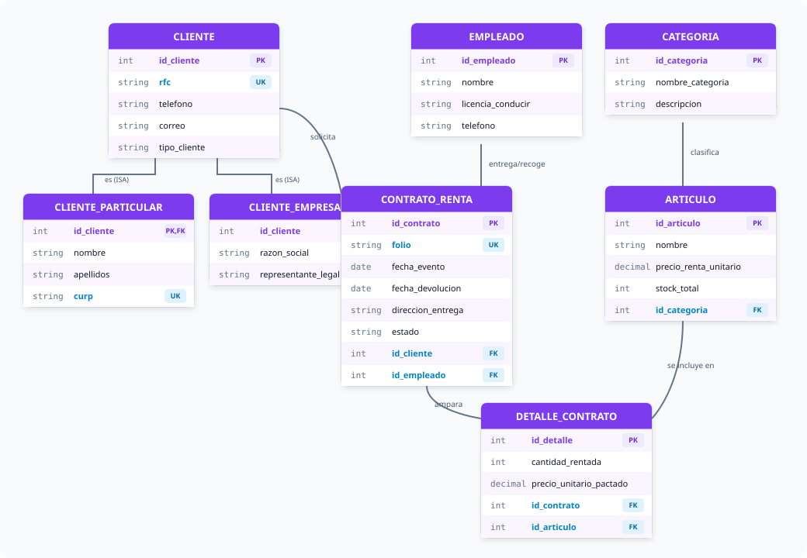

#### Notación Mermaid
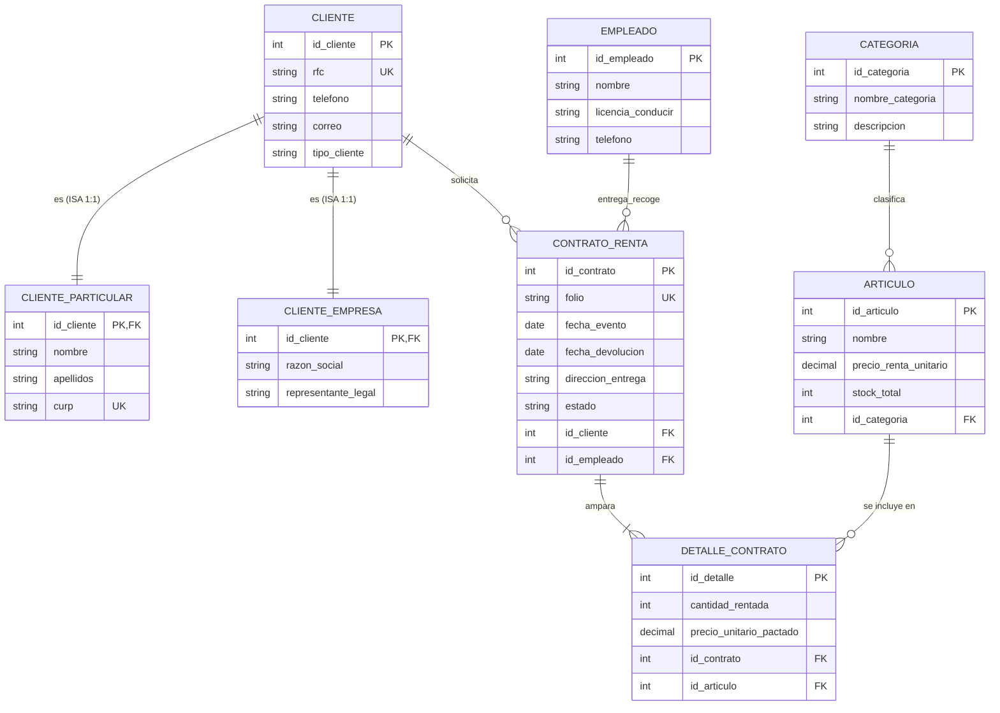

---

## Actividad 6. De Entidad-Relación a Diagramas de Clases UML

> **Fuente:** Presentación y ponencia técnica *"De Entidad-Relación a Diagramas de Clases UML: Integración de bases de datos relacionales al desarrollo de software orientado a objetos"*, autoría de Sheyla Estefanía Moncada Guel ([Actividad 6 U2.pdf](../Actividad%206%20U2.pdf)).

### 1. Planteamiento del Problema: Desfase Objeto-Relacional (*Impedance Mismatch*)
Existe una brecha conceptual fundamental entre la arquitectura de las bases de datos relacionales y la programación orientada a objetos (POO):
- **Bases de Datos Relacionales:** Gestionan datos pasivos organizados en tablas bidimensionales, tuplas, dominios atómicos y claves foráneas.
- **Programación Orientada a Objetos:** Maneja grafos de objetos activos en memoria con comportamiento encapsulado, herencia directa, polimorfismo e interfaces.

**Solución Arquitectónica:** Mapear el modelo conceptual E-R al estándar **Diagrama de Clases UML** para definir formalmente la *Capa de Dominio* de la aplicación de software.

### 2. Reglas de Transformación Sistemáticas:
1. **Transformación de la Herencia EER:** En la base de datos, la superclase `Cliente` se divide en tres tablas con claves foráneas $1:1$ generando columnas nulas y joins costosos. En UML, `Cliente` se modela como una **Clase Abstracta** (`<<abstract>> Cliente`) de la cual heredan `ClienteParticular` y `ClienteEmpresa`, habilitando polimorfismo dinámico limpio.
2. **Asociaciones Simples:** Las claves foráneas $1:N$ (`Empleado` $\to$ `ContratoRenta`) se traducen en asociaciones simples con multiplicidad `1` a `0..*`.
3. **Composición Fuerte:** El ciclo de vida de `DetalleContrato` depende ontológicamente de `ContratoRenta`, por lo que se modela con un **rombo de composición relleno** en UML (`1` a `1..*`), asegurando que si el contrato se elimina, sus líneas de detalle se purguen de la memoria.
4. **Comportamiento Incorporado:** Se inyectan métodos operativos de negocio en las entidades:
   - `calcularMontoTotal(): decimal`
   - `verificarDisponibilidad(cantidad: int): bool`
   - `descontarStock(cantidad: int): void`
   - `cancelarContrato(): bool`

#### Diagrama de Clases UML Vectorial (SVG)

#### Representación en Código Mermaid (Class Diagram)
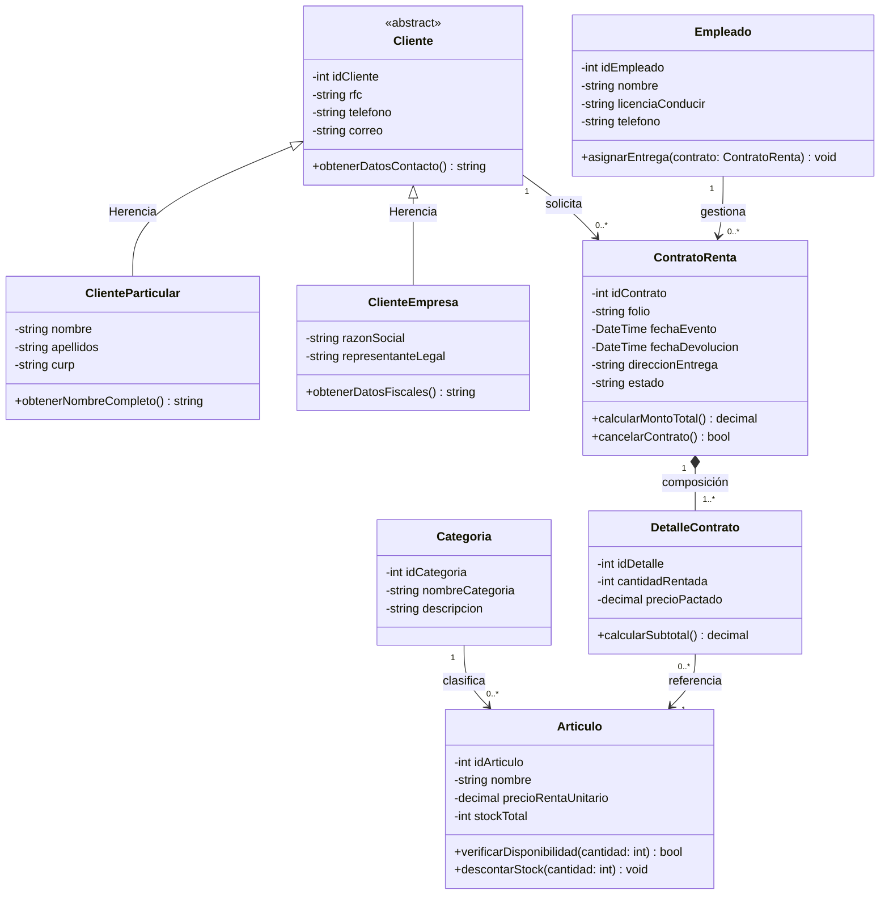

### 3. Conclusiones y Conexión con ORMs
- **Cohesión Arquitectónica:** El mapeo asegura que el equipo de base de datos y los ingenieros de backend compartan el mismo modelo semántico.
- **Automatización ORM:** Herramientas como Entity Framework Core (C# / .NET) o Hibernate (Java) implementan este modelo mediante estrategias de mapeo de herencia (*Table Per Hierarchy* - TPH o *Table Per Type* - TPT).
