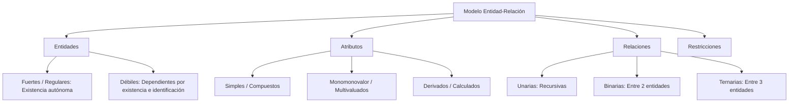
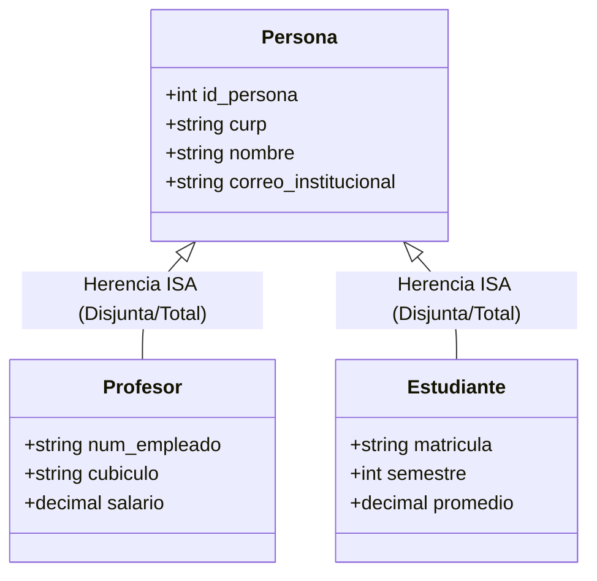

# Unidad 2: Diseño Conceptual - Modelo Entidad-Relación y E-R Extendido

> **Materia:** Fundamentos de Bases de Datos  
> **Estudiante:** Sheyla Estefanía Moncada Guel  
> **Matrícula:** I24050388  
> **Institución:** Instituto Tecnológico Superior Campus Monclova  
> **Archivo Original:** [U2_I24050388.pdf](../U2_I24050388.pdf)

---

## 1. Introducción al Modelo Entidad-Relación (E-R)

El **Modelo Entidad-Relación (E-R)**, introducido formalmente por Peter P. Chen en 1976, es la técnica estándar por excelencia para el diseño conceptual de bases de datos. Permite a los analistas modelar la semántica del mundo real mediante abstracciones de alto nivel que representan las entidades relevantes, sus propiedades características y los vínculos asociativos entre ellas, de forma completamente independiente de cualquier motor gestor o consideraciones de hardware.

Para abordar escenarios de negocio de mayor sofisticación, el modelo tradicional evoluciona hacia el **Modelo Entidad-Relación Extendido (EER - *Enhanced Entity-Relationship*)**, el cual incorpora constructos avanzados de la orientación a objetos como la jerarquía de tipos, superclases, subclases, especialización, generalización y herencia de atributos.

---

## 2. Componentes Fundamentales del Modelo E-R

### 2.1 Entidades
Una entidad es cualquier objeto, persona, lugar o evento del mundo real distinguible sobre el cual la organización necesita recolectar y almacenar datos:
- **Entidad Fuerte (Regular):** Posee existencia propia en el sistema y dispone de un conjunto de atributos que permiten definir una clave primaria única (ej. `Alumno`, `Cliente`, `Empleado`).
- **Entidad Débil:** Su existencia depende ontológicamente de la presencia de una entidad propietaria fuerte. Carece de clave primaria por sí misma y requiere una clave parcial o discriminador en combinación con la clave foránea del padre (ej. `Leccion` respecto a `Curso`, `DetalleContrato` respecto a `ContratoRenta`).

### 2.2 Atributos
Representan las propiedades descriptivas y atómicas de una entidad:
- **Simples (Atómicos):** No se pueden fraccionar en partes más pequeñas (ej. `edad`, `precio_unitario`).
- **Compuestos:** Compuestos por múltiples subcomponentes con significado individual (ej. `nombre_completo` subdividido en `nombre`, `apellido_paterno`, `apellido_materno`; o `direccion` dividida en `calle`, `numero`, `colonia`, `codigo_postal`).
- **Monovaluados:** Contienen un único valor para cada instancia de entidad (ej. `curp`, `fecha_nacimiento`).
- **Multivaluados:** Pueden almacenar un conjunto de valores para la misma entidad (ej. `telefonos`, `correos_secundarios`).
- **Derivados:** Valores que no se almacenan físicamente, sino que se calculan dinámicamente a partir de otros atributos o funciones del sistema (ej. `edad` calculada a partir de `fecha_nacimiento` y la fecha actual).

### 2.3 Claves e Identificadores
- **Superclave:** Uno o varios atributos que identifican unívocamente una tupla en una relación.
- **Clave Candidata:** Superclave mínima irreductible (sin atributos sobrantes).
- **Clave Primaria (PK):** La clave candidata designada oficialmente por el diseñador como identificador maestro inalterable y no nulo.
- **Clave Foránea (FK):** Atributo que enlaza una relación subordinada con la clave primaria de su relación referenciada.

### 2.4 Relaciones y Cardinalidades
Una relación es una asociación semántica entre dos o más entidades:
- **Grado de la Relación:** Cantidad de entidades participantes (Unaria/Recursiva, Binaria, Ternaria).
- **Razón de Cardinalidad:** Razón máxima de instancias que pueden interactuar:
  - **Uno a Uno ($1:1$):** Una instancia de $A$ se asocia con a lo sumo una instancia de $B$ (ej. `Persona` y su `ExpedienteMédico`).
  - **Uno a Muchos ($1:N$):** Una instancia de $A$ se asocia con varias de $B$, pero cada instancia de $B$ se asocia con solo una de $A$ (ej. `Especialidad` y `Médico`).
  - **Muchos a Muchos ($N:M$):** Múltiples instancias de $A$ se relacionan con múltiples instancias de $B$ (ej. `Estudiante` y `Materia`, resuelto conceptualmente mediante `Inscripción`).

---

## 3. Restricciones de Integridad en el Diseño E-R

Para asegurar que el modelo conceptual preserve la fidelidad de las políticas operativas, se aplican cuatro restricciones de diseño:

1. **Restricción de Cardinalidad:** Limita el número mínimo y máximo de asociaciones permitidas para cada entidad en la relación (notaciones de rango $(min, max)$ o pata de gallo *Crow's Foot*).
2. **Restricción de Participación:**
   - **Total (Obligatoria):** Cada entidad del conjunto debe obligatoriamente participar en la relación (representada con línea doble o notación `1`).
   - **Parcial (Opcional):** Algunas entidades pueden no participar en la relación (representada con línea simple o `0..*`).
3. **Restricción de Existencia:** Define la obligatoriedad de permanencia de una entidad dependiente si su entidad padre es eliminada o modificada.
4. **Restricción de Identificación:** Establece el algoritmo o clave compuesta necesaria para discriminar instancias en entidades dependientes débiles.

---

## 4. Modelo Entidad-Relación Extendido (EER)

El Modelo E-R Extendido enriquece el modelo clásico con mecanismos de abstracción estructurados:

### 4.1 Superclases y Subclases
- **Superclase:** Entidad genérica de nivel superior que agrupa todos los atributos comunes y transacciones transversales (ej. `Persona`, `Cliente`).
- **Subclase:** Entidad especializada que representa una subdivisión particular del negocio, heredando la clave primaria y atributos de la superclase y aportando sus atributos y relaciones exclusivos (ej. `Profesor`, `Estudiante`; `ClienteParticular`, `ClienteEmpresa`).

### 4.2 Especialización y Generalización
- **Especialización (*Top-Down*):** Proceso de diseño descendente donde una entidad genérica se descompone en subtipos especializados con base en características distintivas o roles funcionales.
- **Generalización (*Bottom-Up*):** Proceso de diseño ascendente en el que se sintetizan entidades de menor nivel con atributos idénticos en una superclase integradora.

### 4.3 Restricciones EER: Disyunción y Completitud
Las jerarquías de especialización/generalización se rigen estrictamente por dos dimensiones ortogonales:

1. **Restricción de Disyunción:**
   - **Disjunta (*Disjoint - d*):** Una entidad de la superclase puede pertenecer a lo sumo a una única subclase (mutuamente excluyentes).
   - **Solapada (*Overlapping - o*):** Una misma entidad puede ser miembro simultáneamente de dos o más subclases (ej. un empleado que a la vez es estudiante).
2. **Restricción de Completitud:**
   - **Total (*Total Completeness*):** Cada instancia de la superclase debe pertenecer obligatoriamente a alguna de las subclases (representada con doble línea).
   - **Parcial (*Partial Completeness*):** Pueden existir instancias en la superclase que no pertenezcan a ninguna de las subclases definidas.

---

## 5. Referencias Bibliográficas

- **Chen, P. P.** (1976). *The entity-relationship model—toward a unified view of data*. ACM Transactions on Database Systems (TODS), 1(1), 9-36. https://doi.org/10.1145/320434.320440
- **Connolly, T. M., & Begg, C. E.** (2015). *Database Systems: A Practical Approach to Design, Implementation, and Management* (6th ed.). Pearson.
- **Coronel, C., & Morris, S.** (2019). *Database Systems: Design, Implementation, & Management* (13th ed.). Cengage Learning.
- **Date, C. J.** (2004). *Introducción a los sistemas de bases de datos* (8.ª ed.). Pearson Educación.
- **Elmasri, R., & Navathe, S. B.** (2016). *Fundamentals of Database Systems* (7th ed.). Pearson.
- **IBM.** *Entity-Relationship Diagrams (ERD)*. Knowledge Center.
- **Kroenke, D. M., & Auer, D. J.** (2015). *Database Concepts* (7th ed.). Pearson.
- **Marqués, M.** (2011). *Bases de datos* (1.ª ed.). Universitat Jaume I. Servei de Comunicació i Publicacions.
- **Rob, P., & Coronel, C.** (2008). *Sistemas de bases de datos: Diseño, implementación y administración* (7.ª ed.). Cengage Learning Editores.
- **Silberschatz, A., Korth, H. F., & Sudarshan, S.** (2020). *Database System Concepts* (7th ed.). McGraw-Hill Education.
