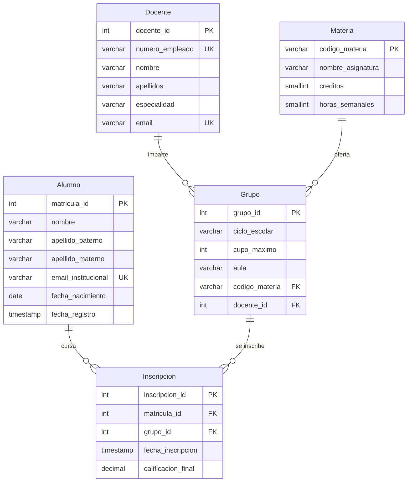
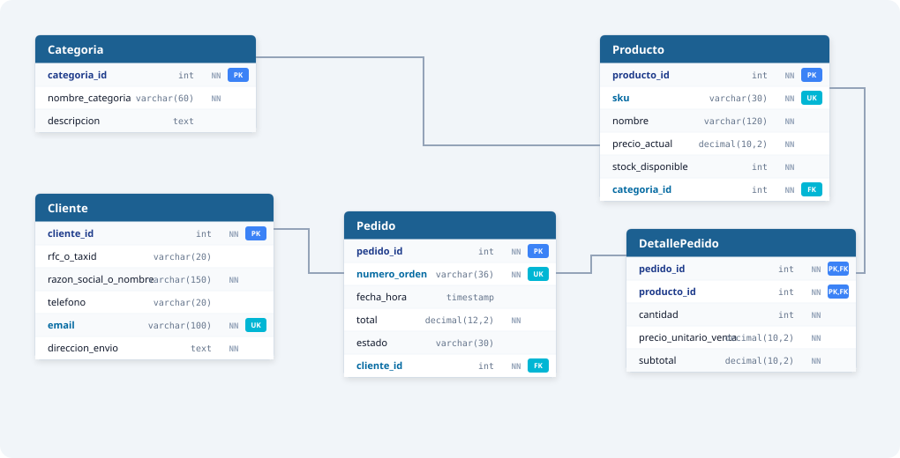
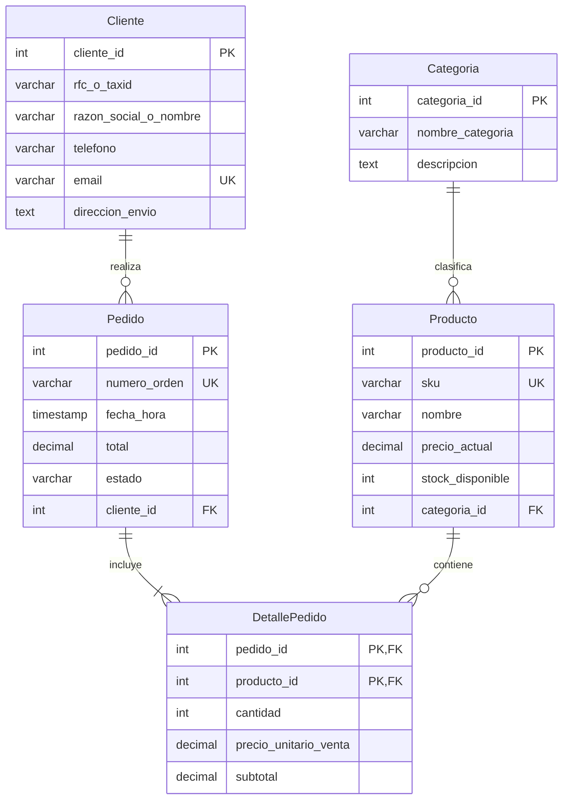
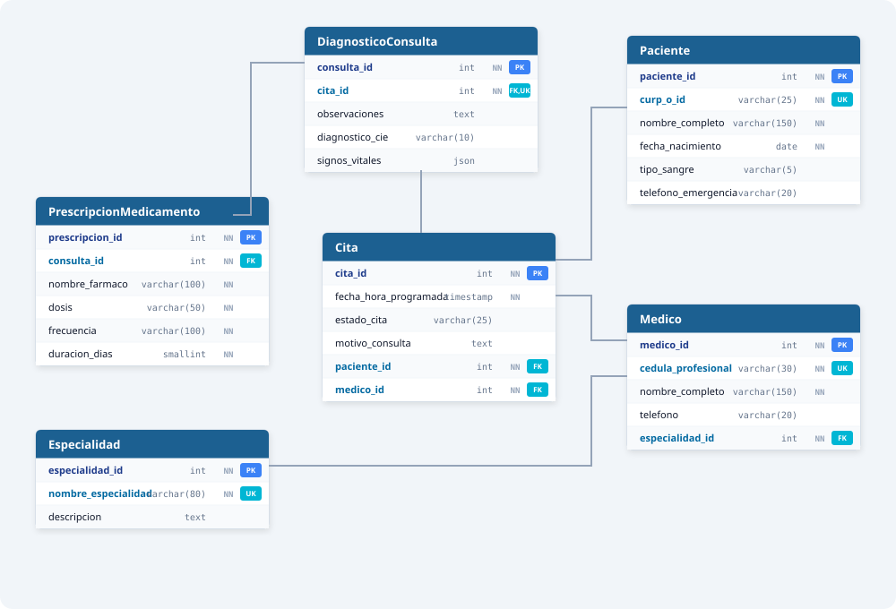
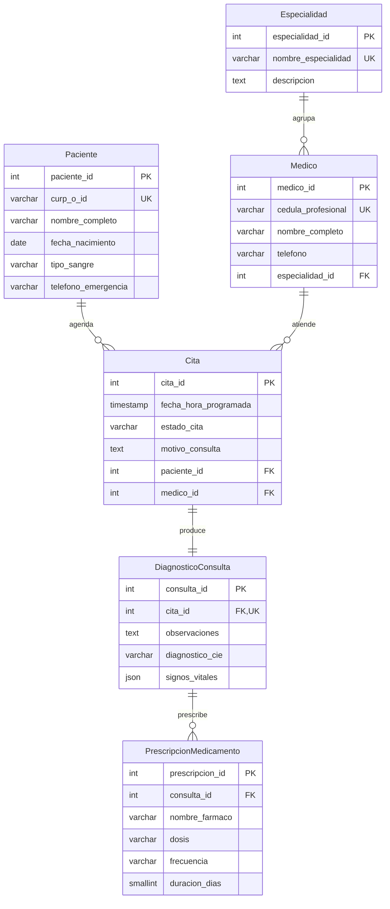
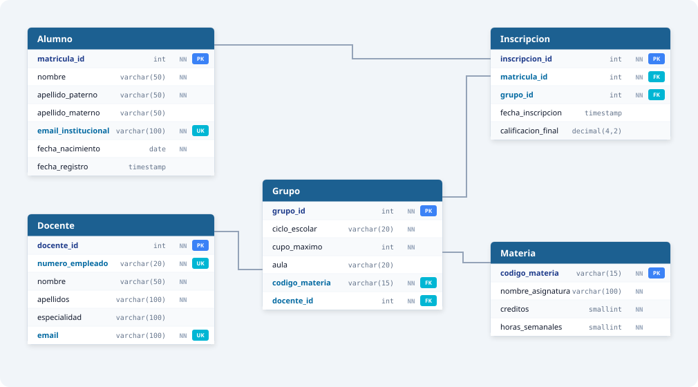
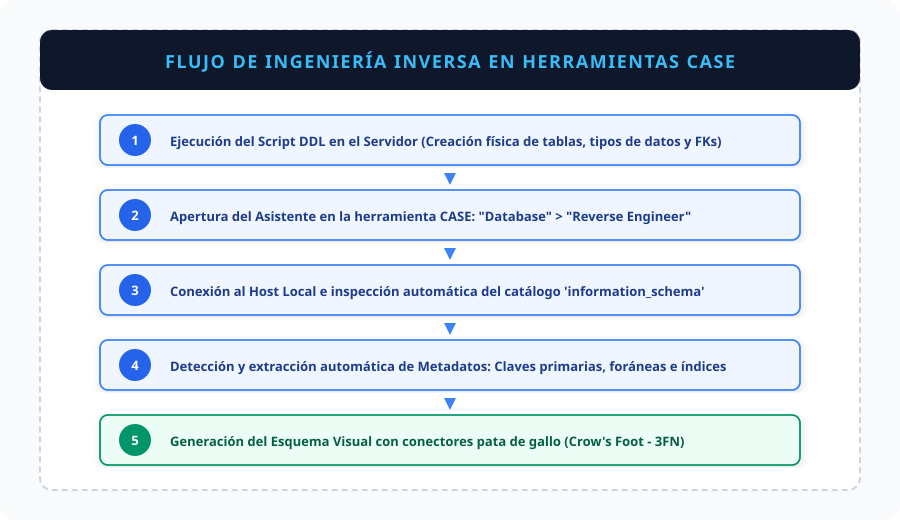
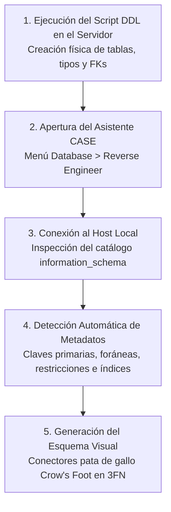

# Actividades Unidad 3: Modelado Relacional, Normalización y DDL SQL

> **Materia:** Fundamentos de Bases de Datos  
> **Estudiante:** Sheyla Estefanía Moncada Guel  
> **Matrícula:** I24050388  
> **Institución:** Instituto Tecnológico Superior Campus Monclova  
> **Documentos Fuente:** [U3_I24050388.pdf](../U3_I24050388.pdf) / [Actividad 3 U3.pdf](../Actividad%203%20U3.pdf)

---

## Índice de Actividades

1. [Actividad 1. Modelo Relacional y Reglas de Integridad](#actividad-1-modelo-relacional-y-reglas-de-integridad)
2. [Actividad 2. Esquemas Relacionales de Tres Casos de Estudio](#actividad-2-esquemas-relacionales-de-tres-casos-de-estudio)
3. [Actividad 3. Transformación del Modelo E-R al Modelo Relacional](#actividad-3-transformación-del-modelo-e-r-al-modelo-relacional)
4. [Actividad 4. Implementación Física DDL (SQL) e Ingeniería Inversa](#actividad-4-implementación-física-ddl-sql-e-ingeniería-inversa)

---

## Actividad 1. Modelo Relacional y Reglas de Integridad

Esta actividad consolida los axiomas y componentes técnicos que sustentan la integridad matemática del modelo relacional:

### Componentes Clave:
- **Relación (Tabla):** Estructura bidimensional de tuplas y atributos.
- **Tupla (Registro):** Instancia única y completa de la relación.
- **Atributo (Columna):** Característica medible definida sobre un dominio homogéneo.
- **Grado vs. Cardinalidad:** El grado corresponde a la cantidad de columnas; la cardinalidad al número total de filas.
- **Teoría de Claves:** Superclave, Clave Candidata mínima, Clave Primaria inalterable y Clave Foránea de interconexión.

### Reglas de Integridad Esenciales:
1. **Integridad de Entidad:** `PK NOT NULL`. Cada fila debe ser distinguible.
2. **Integridad Referencial:** Toda `FK` debe corresponder a una `PK` existente o ser `NULL`.
3. **Integridad de Dominio:** Restricciones de tipo, rango numérico y cláusulas `CHECK`.
4. **Integridad del Usuario:** Reglas avanzadas aplicadas mediante triggers o procedimientos almacenados.

---

## Actividad 2. Esquemas Relacionales de Tres Casos de Estudio

### Caso 1: Sistema de Control Escolar Universitario
- **Contexto:** Control de estudiantes, plantilla docente, catálogo de asignaturas y grupos por periodo lectivo.
- **Cardinalidades:**
  - `Docente` $\to$ `Grupo` ($1:N$): Un docente coordina varios grupos; cada grupo lo imparte un único docente titular.
  - `Materia` $\to$ `Grupo` ($1:N$): Una asignatura oficial se oferta en múltiples grupos.
  - `Alumno` $\leftrightarrow$ `Grupo` ($M:N$): Se descompone mediante la entidad asociativa `Inscripcion` para alojar la calificación final.

#### Esquema Relacional Vectorial (SVG)


#### Notación Mermaid


---

### Caso 2: Plataforma de Comercio Electrónico y Pedidos
- **Contexto:** Tienda digital con catálogo de productos por categorías, clientes y órdenes de compra con congelamiento de precio histórico.
- **Cardinalidades:**
  - `Cliente` $\to$ `Pedido` ($1:N$): Un cliente formaliza múltiples compras.
  - `Categoria` $\to$ `Producto` ($1:N$): Una categoría clasifica varios productos.
  - `Pedido` $\leftrightarrow$ `Producto` ($M:N$): Descompuesta en `DetallePedido` congelando el `precio_unitario_venta` al momento de la transacción.

#### Esquema Relacional Vectorial (SVG)


#### Notación Mermaid


---

### Caso 3: Gestión de Consultas y Citas en Clínica Médica
- **Contexto:** Clínica médica con pacientes, agenda de citas con médicos especialistas, diagnósticos clínicos y prescripción farmacológica.
- **Cardinalidades:**
  - `Especialidad` $\to$ `Medico` ($1:N$): Clasificación profesional de médicos.
  - `Paciente` $\to$ `Cita` ($1:N$) y `Medico` $\to$ `Cita` ($1:N$): Citas agendadas.
  - `Cita` $\to$ `DiagnosticoConsulta` ($1:1$): Cada cita completada produce exactamente un expediente de diagnóstico médico.
  - `DiagnosticoConsulta` $\to$ `PrescripcionMedicamento` ($1:N$): Un diagnóstico médico puede requerir una o varias prescripciones de fármacos.

#### Esquema Relacional Vectorial (SVG)


#### Notación Mermaid


---

## Actividad 3. Transformación del Modelo E-R al Modelo Relacional

> **Fuente:** Ponencia y diapositivas de diseño *"Transformación del Modelo E-R al Modelo Relacional: Identificación de coincidencias, aplicación sistemática de reglas de integridad, normalización y puntos de discusión técnica en grupo"*, por Sheyla Estefanía Moncada Guel ([Actividad 3 U3.pdf](../Actividad%203%20U3.pdf)).

### 1. Tabla de Correspondencia Metodológica
Para transformar formalmente un esquema conceptual E-R al modelo relacional físico, se aplican las siguientes reglas canónicas de conversión:

| Concepto en el Modelo E-R | Objeto en el Modelo Relacional | Criterio de Correspondencia Técnica |
| :--- | :--- | :--- |
| **Entidad Fuerte (Regular)** | Tabla / Relación Base | Almacena instancias con existencia autónoma e identificador propio (`PK`). |
| **Atributo Simple** | Columna (Campo) | Unidad mínima atómica e indivisible con tipo de dato específico (1FN). |
| **Identificador Único** | Clave Primaria (`Primary Key`) | Restricción estricta de no nulidad (`NOT NULL`) y unicidad absoluta por registro. |
| **Relación $1:N$** | Clave Foránea (`Foreign Key`) | Migración y propagación de la clave del lado $1$ hacia la tabla del lado $N$. |
| **Relación $M:N$** | Tabla Asociativa (Puente) | Creación de una tabla intermedia que hospeda las claves foráneas compuestas de ambas entidades y los atributos propios de la relación. |

### 2. Reglas de Transformación Aplicadas:
1. **Transformación de Entidades Regulares:** Se convierten directamente en tablas con sus respectivos campos atómicos (`Alumno`, `Docente`, `Materia`).
2. **Descomposición Atómica (1FN):** El atributo compuesto `Nombre` se subdivide en columnas independientes: `nombre`, `apellido_paterno` y `apellido_materno`.
3. **Definición de Claves Primarias:** Asignación formal de claves únicas obligatorias para impedir la duplicidad de tuplas en el motor.
4. **Restricciones de Integridad de Dominio:** Tipificación precisa de dominios numéricos, textuales, fechas y correos electrónicos con reglas de unicidad (`UNIQUE`).

### 3. Resolución de Cardinalidades y Normalización:
- **Relaciones $1:N$ (Migración de PK):** Las asociaciones `Docente` $\to$ `Grupo` y `Materia` $\to$ `Grupo` se resuelven sin tablas adicionales mediante migración de claves foráneas.
- **Relaciones $M:N$ (Tabla Asociativa):** La interacción entre `Alumno` y `Grupo` se resuelve construyendo la tabla intermedia `Inscripcion`, que hospeda `matricula_id` y `grupo_id`, además de absorber el atributo transaccional `calificacion_final`.
- **Cumplimiento de 3FN:** 
  - **1FN Lograda:** Cada celda almacena datos atómicos y sin listas repetitivas.
  - **2FN Lograda:** Los atributos no clave dependen de la totalidad de la clave primaria.
  - **3FN Lograda:** No existen dependencias funcionales transitivas entre atributos no clave.

### 4. Diccionario de Esquema y Claves:

| Tabla Relacional | Clave Primaria (PK) | Claves Foráneas (FK) | Restricción Específica de Negocio |
| :--- | :--- | :--- | :--- |
| **`Alumno`** | `matricula_id` | Ninguna | `UNIQUE (email_institucional)` |
| **`Docente`** | `docente_id` | Ninguna | `UNIQUE (numero_empleado)`, `UNIQUE (email)` |
| **`Materia`** | `codigo_materia` | Ninguna | `NOT NULL (nombre_asignatura)`, `CHECK (creditos > 0)` |
| **`Grupo`** | `grupo_id` | `codigo_materia`, `docente_id` | FK Referenciales obligatorias, `ON DELETE RESTRICT` |
| **`Inscripcion`** | `inscripcion_id` | `matricula_id`, `grupo_id` | `UNIQUE (matricula_id, grupo_id)`, `CHECK (calificacion_final BETWEEN 0 AND 100)` |

---

## Actividad 4. Implementación Física DDL (SQL) e Ingeniería Inversa

### 1. Representación Visual del Esquema Físico


---

### 2. Código DDL (SQL) Completo y Optimizado

A continuación se presenta el script estándar en lenguaje de definición de datos (**SQL DDL**), compatible con motores **MySQL 8.0+**, **MariaDB** y **PostgreSQL**:

```sql
-- =============================================================================
-- ESQUEMA RELACIONAL: SISTEMA DE CONTROL ESCOLAR UNIVERSITARIO
-- Autor: Sheyla Estefanía Moncada Guel | Matrícula: I24050388
-- Asignatura: Fundamentos de Bases de Datos
-- =============================================================================

-- 1. Creación y selección de la base de datos con soporte UTF-8 completo
CREATE DATABASE IF NOT EXISTS control_escolar_db
    CHARACTER SET utf8mb4 
    COLLATE utf8mb4_unicode_ci;

USE control_escolar_db;

-- 2. Tabla de Entidad Fuerte: ALUMNO
-- Almacena el padrón estudiantil activo. Cumple estrictamente con la Primera 
-- Forma Normal (1FN) al segregar nombres y apellidos en atributos atómicos.
CREATE TABLE alumno (
    matricula_id INT AUTO_INCREMENT,
    nombre VARCHAR(50) NOT NULL,
    apellido_paterno VARCHAR(50) NOT NULL,
    apellido_materno VARCHAR(50) NULL,
    email_institucional VARCHAR(100) NOT NULL,
    fecha_nacimiento DATE NOT NULL,
    fecha_registro TIMESTAMP DEFAULT CURRENT_TIMESTAMP,
    CONSTRAINT pk_alumno PRIMARY KEY (matricula_id),
    CONSTRAINT uq_alumno_email UNIQUE (email_institucional)
) ENGINE=InnoDB;

-- 3. Tabla de Entidad Fuerte: DOCENTE
-- Representa al cuerpo de profesores adscritos. Su identificador natural 
-- institucional (numero_empleado) se protege como clave alternativa única.
CREATE TABLE docente (
    docente_id INT AUTO_INCREMENT,
    numero_empleado VARCHAR(20) NOT NULL,
    nombre VARCHAR(50) NOT NULL,
    apellidos VARCHAR(100) NOT NULL,
    especialidad VARCHAR(100) NULL,
    email VARCHAR(100) NOT NULL,
    CONSTRAINT pk_docente PRIMARY KEY (docente_id),
    CONSTRAINT uq_docente_num_emp UNIQUE (numero_empleado),
    CONSTRAINT uq_docente_email UNIQUE (email)
) ENGINE=InnoDB;

-- 4. Tabla de Entidad Fuerte: MATERIA
-- Catálogo oficial de asignaturas curriculares. Incluye validación de rango.
CREATE TABLE materia (
    codigo_materia VARCHAR(15) NOT NULL,
    nombre_asignatura VARCHAR(100) NOT NULL,
    creditos TINYINT UNSIGNED NOT NULL,
    horas_semanales TINYINT UNSIGNED NOT NULL,
    CONSTRAINT pk_materia PRIMARY KEY (codigo_materia),
    CONSTRAINT chk_materia_creditos CHECK (creditos > 0 AND creditos <= 20)
) ENGINE=InnoDB;

-- 5. Tabla: GRUPO
-- Entidad que materializa la oferta académica. Propaga como Claves Foráneas (FK)
-- las claves primarias de Materia y Docente (cardinalidad 1:N).
CREATE TABLE grupo (
    grupo_id INT AUTO_INCREMENT,
    ciclo_escolar VARCHAR(20) NOT NULL,
    cupo_maximo SMALLINT UNSIGNED NOT NULL DEFAULT 30,
    aula VARCHAR(20) NOT NULL,
    codigo_materia VARCHAR(15) NOT NULL,
    docente_id INT NOT NULL,
    CONSTRAINT pk_grupo PRIMARY KEY (grupo_id),
    CONSTRAINT fk_grupo_materia FOREIGN KEY (codigo_materia)
        REFERENCES materia (codigo_materia)
        ON UPDATE CASCADE
        ON DELETE RESTRICT,
    CONSTRAINT fk_grupo_docente FOREIGN KEY (docente_id)
        REFERENCES docente (docente_id)
        ON UPDATE CASCADE
        ON DELETE RESTRICT
) ENGINE=InnoDB;

-- 6. Tabla Asociativa: INSCRIPCION
-- Resuelve la relación de muchos a muchos (M:N) entre Alumno y Grupo. 
-- Alberga el atributo transaccional de relación 'calificacion_final' (3FN).
CREATE TABLE inscripcion (
    inscripcion_id INT AUTO_INCREMENT,
    matricula_id INT NOT NULL,
    grupo_id INT NOT NULL,
    fecha_inscripcion TIMESTAMP DEFAULT CURRENT_TIMESTAMP,
    calificacion_final DECIMAL(4, 2) NULL,
    CONSTRAINT pk_inscripcion PRIMARY KEY (inscripcion_id),
    CONSTRAINT uq_alumno_grupo UNIQUE (matricula_id, grupo_id),
    CONSTRAINT chk_calificacion_rango CHECK (calificacion_final BETWEEN 0.00 AND 100.00),
    CONSTRAINT fk_inscripcion_alumno FOREIGN KEY (matricula_id)
        REFERENCES alumno (matricula_id)
        ON UPDATE CASCADE
        ON DELETE CASCADE,
    CONSTRAINT fk_inscripcion_grupo FOREIGN KEY (grupo_id)
        REFERENCES grupo (grupo_id)
        ON UPDATE CASCADE
        ON DELETE RESTRICT
) ENGINE=InnoDB;
```

---

### 3. Interpretación de Políticas y Restricciones de Integridad:
1. **Claves Subrogadas (`AUTO_INCREMENT`):** Empleadas en `alumno`, `grupo` e `inscripcion` para maximizar el desempeño en operaciones de búsqueda en disco e indexación mediante árboles B+ (*B-Trees*).
2. **Políticas de Integridad Referencial:**
   - `ON DELETE RESTRICT` en `docente` y `materia`: Impide eliminar una materia o un profesor si ya tienen grupos con alumnos inscritos, protegiendo contra registros huérfanos.
   - `ON UPDATE CASCADE`: Cualquier actualización en un identificador natural (como `codigo_materia`) se replica automáticamente en todos los grupos asociados.
   - `ON DELETE CASCADE` en `alumno`: Si una matrícula es dada de baja administrativamente, sus inscripciones vigentes se purgan limpiamente.
3. **Restricción de Negocio Antiduplicidad:** `CONSTRAINT uq_alumno_grupo UNIQUE (matricula_id, grupo_id)` impide a nivel del motor que un mismo estudiante se inscriba dos veces en el mismo grupo.
4. **Validación de Calificaciones:** `CONSTRAINT chk_calificacion_rango CHECK (calificacion_final BETWEEN 0.00 AND 100.00)` descarta de forma preventiva calificaciones fuera del estándar oficial de acreditación.

---

### 4. Procedimiento de Ingeniería Inversa en Herramientas CASE

Para verificar la consistencia estructural del esquema generado, se llevó a cabo el procedimiento de **ingeniería inversa** (*Reverse Engineering*) en herramientas CASE (MySQL Workbench / DBeaver / dbdiagram):

#### Diagrama de Flujo del Procedimiento




### Resultados de la Validación:
- **Fidelidad Estructural:** El diagrama renderizado reconstruyó las 5 tablas sin pérdida de atributos ni discrepancias de tipos.
- **Trazabilidad de Conectores:** Las líneas de dependencia se asociaron con absoluta exactitud entre `materia` $\to$ `grupo`, `docente` $\to$ `grupo` y `grupo` / `alumno` $\to$ `inscripcion`, confirmando el cumplimiento pleno de la Tercera Forma Normal (3FN).
