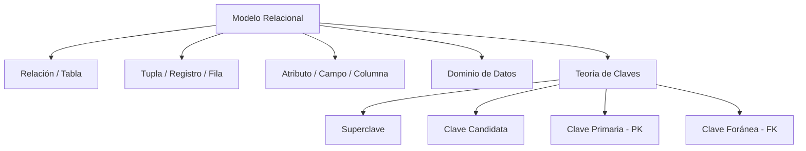

# Unidad 3: Modelo Relacional y Diseño de Base de Datos

> **Materia:** Fundamentos de Bases de Datos  
> **Estudiante:** Sheyla Estefanía Moncada Guel  
> **Matrícula:** I24050388  
> **Institución:** Instituto Tecnológico Superior Campus Monclova  
> **Archivo Original:** [U3_I24050388.pdf](../U3_I24050388.pdf)

---

## 1. Introducción al Modelo Relacional

El **Modelo Relacional** fue formulado originalmente en 1970 por el matemático e informático Edgar Frank Codd en su célebre artículo de investigación *"A Relational Model of Data for Large Shared Data Banks"*. Basado sólidamente en el rigor del **álgebra relacional** y la **teoría de conjuntos de primer orden**, revolucionó la informática al desvincular por completo el acceso lógico a la información de los mecanismos de almacenamiento y punteros en disco.

En la actualidad, los Sistemas Gestores de Bases de Datos Relacionales (SGBD / RDBMS) gobiernan la infraestructura informática global, sustentando transacciones atómicas seguras y consultas estandarizadas mediante el lenguaje **SQL (Structured Query Language)**.

---

## 2. Componentes Fundamentales del Modelo Relacional

El modelo representa los datos y las relaciones del negocio mediante estructuras bidimensionales homogéneas:

### 2.1 Definiciones Conceptuales y Notación Formal:
1. **Relación (Tabla):** Conjunto matemático de tuplas no ordenadas. Cada tabla posee un nombre unívoco y está compuesta por filas y columnas. Formalmente, una relación $R$ sobre los dominios $D_1, D_2, \dots, D_n$ es un subconjunto del producto cartesiano:
   $$R \subseteq D_1 \times D_2 \times \dots \times D_n$$
2. **Tupla (Registro o Fila):** Elemento individual dentro de la relación; representa una instancia particular y atómica de la entidad con sus valores correspondientes.
3. **Atributo (Campo o Columna):** Columna de la tabla con encabezado descriptivo que tipifica una característica cuantificable de la entidad.
4. **Dominio:** Conjunto finito de valores atómicos, indivisibles y semánticamente homogéneos que un atributo puede asumir (tipos primitivos como `INT`, `VARCHAR`, `DECIMAL`, `DATE`, rangos permitidos y restricciones de formato).
5. **Grado:** Cantidad total de atributos (columnas) que integran el esquema de la relación.
6. **Cardinalidad:** Número total de tuplas (filas) que contiene la relación en un momento dado del tiempo.

### 2.2 Jerarquía y Taxonomía de Claves (*Keys*):
- **Superclave:** Cualquier conjunto de uno o más atributos que, tomados en su conjunto, permiten diferenciar unívocamente cada fila de la relación.
- **Clave Candidata (*Candidate Key*):** Superclave mínima que no contiene subconjuntos propios que también sean superclaves (no posee atributos redundantes).
- **Clave Primaria (*Primary Key - PK*):** La clave candidata seleccionada por el arquitecto de datos para identificar de manera exclusiva cada registro. Debe ser inmutable, estable y no nula.
- **Clave Alternativa:** Cualquier clave candidata que no fue escogida como clave primaria (frecuentemente protegida mediante restricciones `UNIQUE`).
- **Clave Foránea (*Foreign Key - FK*):** Atributo (o grupo de atributos) cuyos valores hacen referencia directa a la clave primaria de otra tabla (o de la misma), materializando los vínculos relacionales y la integridad referencial.

---

## 3. Reglas de Integridad Básicas del Modelo Relacional

Las reglas de integridad son axiomas formales que el motor relacional impone de manera invariable para impedir la corrupción o inconsistencia de los datos:

1. **Integridad de Entidad (*Entity Integrity*):** Ningún atributo que forme parte de la clave primaria (`PK`) puede contener valores nulos (`NULL`). Cada registro debe ser identificable en todo momento.
2. **Integridad Referencial (*Referential Integrity*):** Si una tabla contiene una clave foránea (`FK`), el valor presente en cada fila debe coincidir exactamente con un valor de clave primaria existente en la tabla padre referenciada, o bien ser nulo (`NULL`) si la regla de negocio contempla participaciones opcionales.
3. **Integridad de Dominio (*Domain Integrity*):** Cada valor almacenado en un campo debe pertenecer estrictamente al conjunto de valores válidos definido para su dominio (tipo de dato, longitud máxima, cotejamiento de caracteres y restricciones lógicas tipo `CHECK`).
4. **Integridad Definida por el Usuario (*User-Defined Integrity*):** Reglas empresariales específicas del caso de uso (disparadores /*triggers*/, procedimientos almacenados y aserciones) no cubiertas de manera nativa por las reglas estándar del motor.

---

## 4. Normalización y Formas Normales (1FN a 3FN)

La normalización es el proceso algorítmico y metodológico de descomposición de esquemas relacionales para eliminar la redundancia innecesaria y proteger la base de datos contra anomalías de inserción, modificación y eliminación:

| Forma Normal | Principio Matemático | Anomalías Erradicadas | Criterio de Verificación Práctica |
| :--- | :--- | :--- | :--- |
| **Primera Forma Normal (1FN)** | **Atomicidad de Valores:** Cada celda tabular debe contener un único valor indivisible del dominio. No se permiten listas, conjuntos repetitivos ni campos compuestos. | Impide la presencia de datos no estructurados y dependencias de posición. | Segregar atributos compuestos (ej. dividir `nombre_completo` en `nombre`, `apellido_paterno`, `apellido_materno`). |
| **Segunda Forma Normal (2FN)** | **Dependencia Funcional Total:** Debe estar en 1FN y todo atributo no clave debe depender funcionalmente de la totalidad de la clave primaria, y no de una parte de ella. | Erradica anomalías de actualización en tablas con claves primarias compuestas ($PK_1, PK_2$). | Mover atributos que dependen parcialmente a una tabla independiente vinculada por FK. |
| **Tercera Forma Normal (3FN)** | **Dependencia No Transitiva:** Debe estar en 2FN y ningún atributo no clave debe depender funcionalmente de otro atributo no clave ($X \to Y$ donde ninguno es superclave). | Suprime redundancias en cadena e inconsistencias históricas en catálogos auxiliares. | Extraer catálogos secundarios a tablas maestras (ej. aislar `categoria` y su `descripcion` fuera de `producto`). |
| **Formas Avanzadas (FNBC / 4FN)** | **Forma Normal de Boyce-Codd y Cuarta Forma Normal:** Todo determinante es superclave estricta y se eliminan dependencias multivaluadas no triviales. | Garantiza la consistencia matemática absoluta en transacciones complejas. | Reestructuración de dependencias multivaluadas independientes. |

---

## 5. Referencias Bibliográficas

- **Chen, P. P.** (1976). *The entity-relationship model—toward a unified view of data*. ACM Transactions on Database Systems, 1(1), 9–36. https://doi.org/10.1145/320434.320440
- **Codd, E. F.** (1970). *A relational model of data for large shared data banks*. Communications of the ACM, 13(6), 377–387. https://doi.org/10.1145/362384.362685
- **Connolly, T. M., & Begg, C. E.** (2015). *Database Systems: A Practical Approach to Design, Implementation, and Management* (6th ed.). Pearson.
- **Coronel, C., & Morris, S.** (2019). *Database systems: Design, implementation, & management* (13.ª ed.). Cengage Learning.
- **Date, C. J.** (2004). *An introduction to database systems* (8.ª ed.). Pearson Education.
- **Elmasri, R., & Navathe, S. B.** (2016). *Fundamentals of database systems* (7.ª ed.). Pearson.
- **Silberschatz, A., Korth, H. F., & Sudarshan, S.** (2020). *Database system concepts* (7.ª ed.). McGraw-Hill Education.
