# 📒 Tarea 5.1: Operadores Fundamentales y Extendidos del Álgebra Relacional

---

## 👤 Datos de Identificación

- **Nombre:** Sheyla Estefania Moncada Guel
- **Matricula:** I24050388
- **Maestro:** Ruben Riojas
- **Asignatura:** Fundamentos de Bases de Datos
- **Unidad:** [Unidad 5 — Álgebra Relacional](../)

---

## 📝 Descripción

En esta actividad se investiga el marco teórico y la notación matemática del **Álgebra Relacional** propuesta por E. F. Codd (1970) como lenguaje procedimental de consultas basado en la propiedad de **Cierre Algebraico**:
1. **Operadores Unarios Fundamentales:** Selección ($\sigma_P(R)$ — filtrado horizontal), Proyección ($\pi_L(R)$ — filtrado vertical) y Renombramiento ($\rho_S(R)$).
2. **Operadores Binarios Fundamentales:** Producto Cartesiano ($R \times S$), Unión ($R \cup S$) y Diferencia de Conjuntos ($R - S$).
3. **Operadores Derivados y Compuestos:** Intersección ($R \cap S$), Reunión Condicional / Theta-Join ($R \bowtie_P S$), Reunión Natural ($R \bowtie S$) y División ($R \div S$).
4. **Álgebra Relacional Extendida:** Proyección Generalizada ($\pi^*$), Funciones de Agregación y Agrupamiento ($_{A}\mathcal{G}_{F}(R)$) y Reuniones Externas (*Left, Right, Full Outer Join*).

---

## 📊 Visualización de Gráficos

### 1. Taxonomía de Operadores del Álgebra Relacional (Mermaid.js)

```mermaid
flowchart TD
    AR["🧮 ÁLGEBRA RELACIONAL<br/>(Cierre Algebraico)"]

    AR --> UN["1. Operadores Unarios<br/>Fundamentales"]
    AR --> BIN["2. Operadores Binarios<br/>Fundamentales"]
    AR --> DER["3. Operadores Derivados<br/>y Compuestos"]
    AR --> EXT["4. Álgebra Relacional<br/>Extendida"]

    UN --> U1["Selección: σ_P(R)<br/>(Filtrado horizontal de filas)"]
    UN --> U2["Proyección: π_L(R)<br/>(Filtrado vertical de columnas)"]
    UN --> U3["Renombramiento: ρ_S(R)<br/>(Alias de relación/atributos)"]

    BIN --> B1["Producto Cartesiano: R × S<br/>(Combinación total de tuplas)"]
    BIN --> B2["Unión: R ∪ S<br/>(Tuplas en R o en S, Union-Compatible)"]
    BIN --> B3["Diferencia: R − S<br/>(Tuplas en R que no están en S)"]

    DER --> D1["Intersección: R ∩ S<br/>R − (R − S)"]
    DER --> D2["Theta-Join y Natural Join: R ⋈ S<br/>σ_P(R × S)"]
    DER --> D3["División: R ÷ S<br/>(Cuantificación universal: TODOS)"]

    EXT --> E1["Proyección Generalizada: π*<br/>(Expresiones aritméticas)"]
    EXT --> E2["Agrupación y Agregación: 𝒢<br/>(COUNT, SUM, AVG, MIN, MAX)"]
    EXT --> E3["Outer Joins: ⟕, ⟖, ⟗<br/>(Preservación de tuplas con NULL)"]

    classDef root fill:#1e293b,stroke:#0f172a,color:#ffffff,font-weight:bold;
    classDef groupNode fill:#1d4ed8,stroke:#1e40af,color:#ffffff,font-weight:bold;
    classDef opNode fill:#f1f5f9,stroke:#94a3b8,color:#0f172a;

    class AR root;
    class UN,BIN,DER,EXT groupNode;
    class U1,U2,U3,B1,B2,B3,D1,D2,D3,E1,E2,E3 opNode;
```

### 2. Matriz Comparativa Sintética de Operadores del Álgebra Relacional

| Operador | Símbolo | Tipo | Requisito de Esquema | Propósito Principal |
| :--- | :---: | :---: | :--- | :--- |
| **Selección** | $\sigma_P(R)$ | Unario | Cualquiera | Filtrado horizontal de filas según condición $P$. |
| **Proyección** | $\pi_L(R)$ | Unario | Cualquiera | Filtrado vertical de columnas y eliminación de duplicados. |
| **Renombramiento** | $\rho_S(R)$ | Unario | Cualquiera | Cambiar nombre de relación o atributos. |
| **Unión** | $R \cup S$ | Binario | *Union-Compatible* | Combinar tuplas de dos relaciones compatibles. |
| **Diferencia** | $R - S$ | Binario | *Union-Compatible* | Tuplas presentes en $R$ que no están en $S$. |
| **Prod. Cartesiano** | $R \times S$ | Binario | Disjuntos | Combinación cartesiana de todas las filas. |
| **Intersección** | $R \cap S$ | Derivado | *Union-Compatible* | Tuplas comunes presentes tanto en $R$ como en $S$. |
| **Theta-Join** | $R \bowtie_P S$ | Derivado | Arbitrarios | Combinación basada en un predicado explícito $P$. |
| **Natural Join** | $R \bowtie S$ | Derivado | Atributos compartidos | Combinación por igualdad de columnas comunes. |
| **División** | $R \div S$ | Derivado | Atributos compartidos | Filtrar entidades asociadas a **TODAS** las tuplas de $S$. |
| **Agregación** | $_{A}\mathcal{G}_{F}(R)$ | Extendido | Cualquiera | Agrupamiento y funciones estadísticas (`SUM`, `AVG`, `COUNT`). |
| **Outer Join** | $R \ S$ / $⟖$ / $⟗$ | Extendido | Atributos compartidos | Conservar tuplas sin coincidencia rellenando con `NULL`. |

---

## 📦 Entregable

- 📄 **Documento de la Actividad:** [`Tarea_5.1.docx`](./Tarea_5.1.docx) *( / [`Tarea_5.1.pdf`](./Tarea_5.1.pdf))*
- 🎥 **Video Explicativo en YouTube:** [Ver video en YouTube](https://www.youtube.com/watch?v=PEGAR_ID_DE_VIDEO_AQUI)

