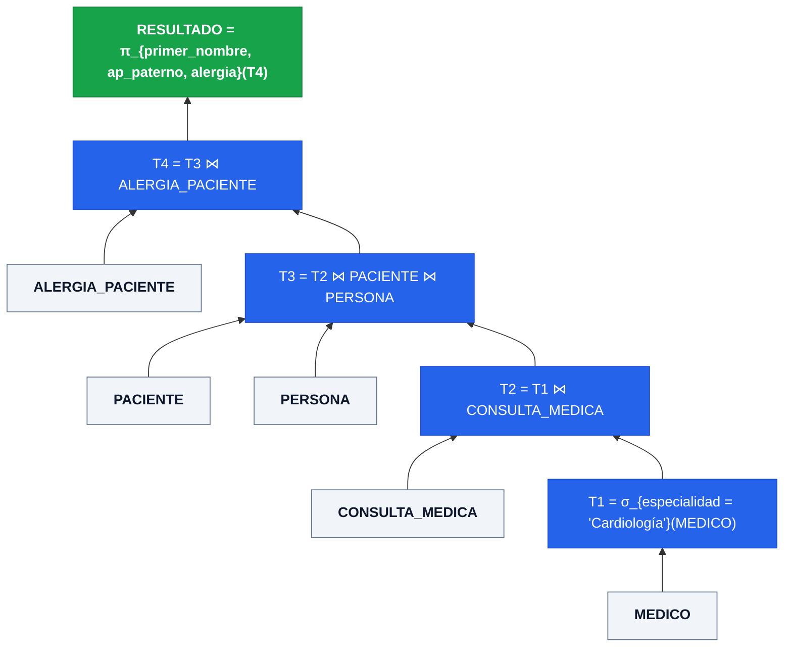

# 📒 Tarea 5.2: Resolución de Consultas sobre el Esquema Relacional con Álgebra Formal

---

## 👤 Datos de Identificación

- **Nombre:** Sheyla Estefania Moncada Guel
- **Matricula:** I24050388
- **Maestro:** Ruben Riojas
- **Asignatura:** Fundamentos de Bases de Datos
- **Unidad:** [Unidad 5 — Álgebra Relacional](../)

---

## 📝 Descripción

En esta actividad se resuelve un catálogo estructurado de **10 consultas formales en Álgebra Relacional** sobre el esquema normalizado en `3FN/FNBC` del **Sistema de Información Hospitalaria (HIS)**. Cada consulta incluye:
1. Especificación del requerimiento en lenguaje natural (niveles básico, intermedio, complejo y avanzado).
2. Expresión matemática en Álgebra Relacional.
3. Desglose procedimental paso a paso mediante **tablas intermedias** ($T_1, T_2, \dots, \text{RESULTADO}$) y árbol de ejecución algebraico.
4. Traducción directa a su sentencia equivalente en **SQL `SELECT`**.

---

## 📊 Visualización de Gráficos

### 1. Árbol de Ejecución Algebraica (Ejemplo: Consulta 4 — Pacientes con Alergias atendidos en Cardiología)

Expresión formal:
$$\pi_{\text{primer\_nombre, ap\_paterno, alergia}} \left( \sigma_{\text{especialidad} = \text{'Cardiología'}}(\text{MEDICO}) \bowtie \text{CONSULTA\_MEDICA} \bowtie \text{PACIENTE} \bowtie \text{PERSONA} \bowtie \text{ALERGIA\_PACIENTE} \right)$$

### 2. Resumen del Catálogo de 10 Consultas y Matriz de Mapeo a SQL

| # | Nivel | Operadores Algebraicos Empleados | Propósito Clínico en el HIS |
| :---: | :---: | :--- | :--- |
| **1** | Básica | $\pi$, $\bowtie_{\text{curp}}$ | Nombre completo y especialidad de todos los médicos. |
| **2** | Básica | $\pi$, $\sigma_{\text{AND}}$, $\bowtie$ | Pacientes con sangre `O+` nacidos antes del año `2000`. |
| **3** | Intermedia | $\pi$, $\sigma$ | Fecha, síntomas y diagnóstico de consultas del médico `CED-1002`. |
| **4** | Intermedia | $\pi$, $\sigma$, $\bowtie$ múltiple (`N:M`) | Nombres y alergias de pacientes atendidos en `Cardiología`. |
| **5** | Intermedia | $\pi$, Diferencia ($-$) | Expedientes de pacientes ambulatorios que nunca han sido internos (`EXCEPT`). |
| **6** | Compleja | $_{\text{especialidad}}\mathcal{G}_{\text{COUNT, AVG}}$, $\bowtie$ | Total de consultas y sueldo promedio agrupado por especialidad. |
| **7** | Compleja | $\sigma_{\text{total}>5}$, $\mathcal{G}_{\text{COUNT}}$, $\bowtie$ | Especialidades con más de 5 consultas registradas (`HAVING`). |
| **8** | Compleja | $\pi$, Left Outer Join ($\$) | Todos los médicos y fechas de consulta, incluyendo médicos sin consultas (`LEFT JOIN`). |
| **9** | Avanzada | División ($\div$), $\pi$, $\bowtie$ | Pacientes recetados con **TODOS** los medicamentos del catálogo. |
| **10** | Avanzada | $\sigma_{\text{total}>50}$, $\mathcal{G}_{\text{SUM}}$, $\bowtie$ | Medicamentos con más de 50 unidades prescritas acumuladas. |

### 3. Matriz de Correspondencia: Álgebra Relacional vs. Lenguaje SQL

| Operador Relacional | Símbolo Matemático | Cláusula / Elemento SQL | Propósito en el Motor |
| :--- | :---: | :--- | :--- |
| **Selección** | $\sigma_P(R)$ | `WHERE` / `HAVING` | Filtrado horizontal de tuplas. |
| **Proyección** | $\pi_L(R)$ | `SELECT DISTINCT col1, col2` | Filtrado vertical de columnas. |
| **Producto Cartesiano** | $R \times S$ | `FROM R CROSS JOIN S` | Combinación cartesiana de registros. |
| **Reunión / Join** | $R \bowtie_P S$ | `INNER JOIN ... ON P` | Combinación de tablas basada en predicado. |
| **Unión** | $R \cup S$ | `UNION` | Unificación de conjuntos de tuplas. |
| **Diferencia** | $R - S$ | `EXCEPT` / `NOT EXISTS` | Resta relacional entre conjuntos compatibles. |
| **Agregación** | $_{A}\mathcal{G}_{F}(R)$ | `GROUP BY` + `SUM`, `COUNT`, `AVG` | Agrupamiento de datos e indicadores. |
| **Left Outer Join** | $R \ S$ | `LEFT OUTER JOIN ... ON` | Inclusión de tuplas no coincidentes de $R$. |

---

## 📦 Entregable

- 📄 **Documento de la Actividad:** [`Tarea_5.2.docx`](./Tarea_5.2.docx) *( / [`Tarea_5.2.pdf`](./Tarea_5.2.pdf))*
- 🎥 **Video Explicativo en YouTube:** [Ver video en YouTube](https://www.youtube.com/watch?v=PEGAR_ID_DE_VIDEO_AQUI)

