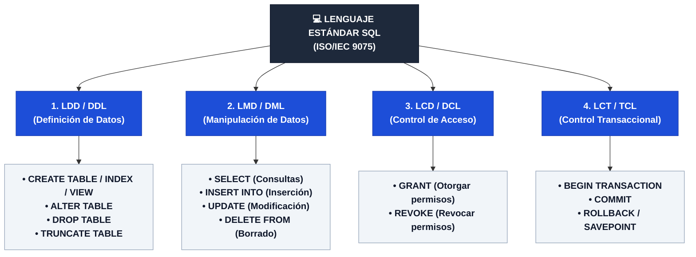

# 📓 Tarea 6.1: Sintaxis y Clasificación de Sentencias SQL (LDD y LMD)

---

## 👤 Datos de Identificación

- **Nombre:** Sheyla Estefania Moncada Guel
- **Matricula:** I24050388
- **Maestro:** Ruben Riojas
- **Asignatura:** Fundamentos de Bases de Datos
- **Unidad:** [Unidad 6 — Introducción al Lenguaje SQL (LDD y LMD)](../)

---

## 📝 Descripción

En esta actividad se analiza la arquitectura declarativa y la gramática formal **EBNF** del **Lenguaje de Consulta Estructurado (SQL)** bajo el estándar ISO/IEC 9075:
1. **Capas Lógicas del Lenguaje SQL:** División en sublenguajes LDD/DDL (Definición), LMD/DML (Manipulación), LCD/DCL (Control) y LCT/TCL (Transacciones).
2. **Taxonomía Comparativa LDD vs. LMD:** Evaluación técnica por propósito, objeto de operación, impacto en el catálogo del sistema, comportamiento transaccional (*autocommit* vs. bloques TCL), registro en bitácora WAL y disparo de *triggers*.
3. **Sintaxis Formal EBNF:** Especificación detallada de `CREATE TABLE`, `ALTER TABLE`, `DROP TABLE`, `TRUNCATE TABLE`, `INSERT`, `UPDATE`, `DELETE` y `SELECT`.

---

## 📊 Visualización de Gráficos

### 1. Clasificación de Sublenguajes SQL y Pipeline de Ejecución Declarativa (Mermaid.js)

### 2. Tabla Comparativa: Sublenguaje LDD (DDL) vs. Sublenguaje LMD (DML)

| Criterio de Análisis | Sublenguaje LDD (DDL) | Sublenguaje LMD (DML) |
| :--- | :--- | :--- |
| **Propósito Primario** | Definir y estructurar esquemas y metadatos (`CREATE`, `ALTER`, `DROP`, `TRUNCATE`). | Insertar, consultar, actualizar y eliminar tuplas (`SELECT`, `INSERT`, `UPDATE`, `DELETE`). |
| **Objeto de Operación** | Estructuras de catálogo (tablas, índices, vistas, restricciones). | Registros individuales o conjuntos de tuplas (filas). |
| **Modificación del Catálogo** | **SÍ:** Actualiza directamente el Diccionario de Datos. | **NO:** Opera sobre las filas sin alterar metadatos estructurales. |
| **Mecanismo Transaccional** | *Autocommit* implícito en la mayoría de los SGBD. | Requiere `COMMIT` o `ROLLBACK` explícito dentro de bloques TCL. |
| **Nivel de Registro (WAL)** | Mínimo (asignación/desasignación de páginas de disco). | Extensivo (valores previos *undo* y posteriores *redo* fila por fila). |
| **Ejecución de Triggers** | No dispara *triggers* DML convencionales. | Activa *triggers* DML (`BEFORE` / `AFTER INSERT`, `UPDATE`, `DELETE`). |

### 3. Comparativa Operativa: `DROP TABLE` vs. `TRUNCATE TABLE` vs. `DELETE FROM`

| Dimensión Operativa | `DROP TABLE` | `TRUNCATE TABLE` | `DELETE FROM` |
| :--- | :--- | :--- | :--- |
| **Categoría de Comando** | Lenguaje DDL | Lenguaje DDL | Lenguaje DML |
| **Efecto en la Estructura** | Destruye la tabla y la remueve del catálogo. | Conserva la estructura intacta en el catálogo. | Conserva la estructura intacta en el catálogo. |
| **Mapeo de Datos** | Elimina descriptores y archivos en disco. | Desasigna páginas de almacenamiento masivo. | Borra tuplas individualmente (*Row-by-Row*) con filtro `WHERE`. |
| **Rendimiento / WAL Log** | Inmediato. Registro mínimo de metadatos. | Ultra-rápido. Registra solo desasignación de páginas. | Más lento en volúmenes masivos; alto registro en WAL. |
| **Reseteo de Secuencias** | N/A (la tabla deja de existir). | `RESTART IDENTITY` reinicia contadores automáticos. | Mantiene la secuencia en el valor actual. |

---

## 📦 Entregable

- 📄 **Documento de la Actividad:** [`Tarea_6.1.docx`](./Tarea_6.1.docx) *( / [`Tarea_6.1.pdf`](./Tarea_6.1.pdf))*
- 🎥 **Video Explicativo en YouTube:** [Ver video en YouTube](https://www.youtube.com/watch?v=PEGAR_ID_DE_VIDEO_AQUI)

