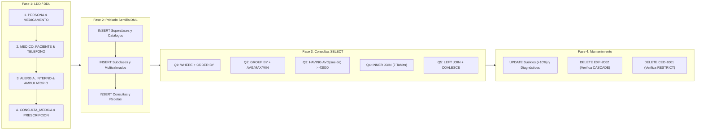

# 📓 Tarea 6.2: Implementación de Script DDL, Carga de Datos y Consultas DML

---

## 👤 Datos de Identificación

- **Nombre:** Sheyla Estefania Moncada Guel
- **Matricula:** I24050388
- **Maestro:** Ruben Riojas
- **Asignatura:** Fundamentos de Bases de Datos
- **Unidad:** [Unidad 6 — Introducción al Lenguaje SQL (LDD y LMD)](../)

---

## 📝 Descripción

En esta actividad integradora se desarrolla el script SQL completo en **cuatro fases secuenciales** para el **Sistema de Información Hospitalaria (HIS)**:
1. **Fase 1 — Lenguaje de Definición de Datos (LDD / DDL):** Creación jerárquica de las 10 tablas del sistema (`PERSONA`, `TELEFONO_PERSONA`, `MEDICO`, `PACIENTE`, `ALERGIA_PACIENTE`, `PACIENTE_INTERNO`, `PACIENTE_AMBULATORIO`, `CONSULTA_MEDICA`, `MEDICAMENTO`, `PRESCRIPCION_DETALLE`) con sus restricciones `PK`, `FK`, `UNIQUE`, `CHECK` y `NOT NULL`.
2. **Fase 2 — Lenguaje de Manipulación de Datos (LMD - Poblado Semilla):** Inserción de datos de prueba (`INSERT INTO`) respetando el orden de integridad referencial.
3. **Fase 3 — Banco de Consultas LMD (`SELECT` Avanzados):** Consultas con filtrado y ordenamiento (`WHERE` + `ORDER BY`), agrupamiento y agregación (`GROUP BY` + `COUNT`, `AVG`, `MAX`, `MIN`), filtro de grupos (`HAVING`), reunión interna múltiple (`INNER JOIN` de 7 tablas) y reunión externa izquierda (`LEFT JOIN` + `COALESCE`).
4. **Fase 4 — Mantenimiento y Pruebas de Integridad Referencial:** Operaciones `UPDATE` y `DELETE` verificando el borrado automático en cascada (`ON DELETE CASCADE`) y el bloqueo protector (`ON DELETE RESTRICT`).

---

## 📊 Visualización de Gráficos

### 1. Arquitectura en 4 Fases del Despliegue SQL del Sistema Hospitalario (Mermaid.js)

### 2. Resumen del Banco de Consultas y Pruebas (Fases 3 y 4)

| Fase / Operación | Cláusulas SQL Utilizadas | Objetivo Técnico en el Sistema Hospitalario (HIS) |
| :--- | :--- | :--- |
| **Consulta 1** | `JOIN`, `WHERE`, `ORDER BY ASC` | Obtener expedientes y tipo de sangre de pacientes nacidos antes del año `2000`. |
| **Consulta 2** | `GROUP BY`, `COUNT`, `AVG`, `MAX`, `MIN` | Calcular total de médicos y sueldos promedio, máximo y mínimo por especialidad. |
| **Consulta 3** | `GROUP BY`, `HAVING AVG(sueldo) > 43000` | Filtrar especialidades médicas con sueldo promedio superior a `\$43,000`. |
| **Consulta 4** | `INNER JOIN` (7 tablas encadenadas) | Reporte clínico integral con médico, especialidad, paciente, diagnóstico y fármaco recetado. |
| **Consulta 5** | `LEFT JOIN`, `COUNT`, `COALESCE(SUM(...), 0)` | Listar **todos** los medicamentos del catálogo (incluyendo no recetados) y sus unidades totales. |
| **Mantenimiento 1** | `UPDATE ... SET ... WHERE` | Incremento salarial del `10%` en `Cardiología` y actualización de diagnóstico clínico. |
| **Mantenimiento 2** | `DELETE FROM PACIENTE` (`ON DELETE CASCADE`) | Al eliminar `EXP-2002`, se purgan automáticamente sus filas en `ALERGIA_PACIENTE` y `PACIENTE_INTERNO`. |
| **Mantenimiento 3** | `DELETE FROM MEDICO` (`ON DELETE RESTRICT`) | Impide borrar al médico `CED-1001` porque posee historial activo en `CONSULTA_MEDICA`. |

---

## 📦 Entregable

- 📄 **Documento de la Actividad:** [`Tarea_6.2.docx`](./Tarea_6.2.docx) *( / [`Tarea_6.2.pdf`](./Tarea_6.2.pdf))*
- 🎥 **Video Explicativo en YouTube:** [Ver video en YouTube](https://www.youtube.com/watch?v=PEGAR_ID_DE_VIDEO_AQUI)

